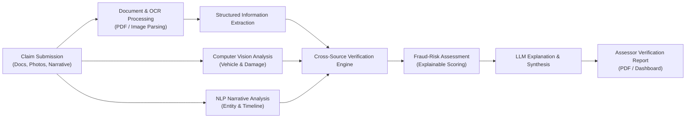

# ClaimSense AI

> **AI-Powered Insurance Claim Verification Using Image & Document Analysis**  
> *Final-Year B.Tech Major Project &mdash; Academic Decision-Support Prototype*

---

> [!IMPORTANT]
> **Academic Scope & Legal Disclaimer:**  
> ClaimSense AI is designed strictly as an academic decision-support prototype to assist human claim assessors by detecting inconsistencies across multi-source evidence (policy records, claim forms, bills, claimant narrative statements, and vehicle images). It is **NOT** an autonomous claim adjudication system and does **NOT** assert or prove legal fraud.

---

## 👥 Project Team & Supervision

**Institution:** ABES Engineering College, Ghaziabad  
**Department:** Department of Computer Science & Engineering  
**Session:** 2026–2027  
**Supervisor:** Ms. Sonia Lamba, Assistant Professor, Department of CSE  

**Project Team:**
1. **Ansh Gupta** &mdash; Roll No. 2300320120051
2. **Ankit Yadav** &mdash; Roll No. 2300320120048
3. **Ananya Chauhan** &mdash; Roll No. 2300320120041

---

## 📌 Project Overview

Motor insurance claim processing often involves reconciling disparate and unstructured data points:
- Official policy schedules
- Submitted claim application forms
- Repair estimates and garage invoices
- First-person claimant accident descriptions
- Photographic evidence of vehicle damage

Manual cross-referencing across these sources is time-consuming and prone to oversight. **ClaimSense AI** provides an explainable verification pipeline that extracts structured entities across documents, performs visual component inspection on vehicle photographs, cross-verifies facts using a deterministic rule engine, computes an explainable risk score (Low / Medium / High), and generates transparent audit summaries for human assessors.

---

## 🏛️ Pipeline Architecture



---

## 📁 Repository Structure

```text
ClaimSense-AI/
├── backend/
│   ├── app.py                     # Flask application factory & server entry point
│   ├── config.py                  # Environment-driven configuration (DB, uploads, secrets)
│   ├── database/                  # Phase 3: Relational persistence layer
│   │   ├── __init__.py            # Package exports
│   │   ├── db.py                  # SQLAlchemy engine, session management & legacy migration
│   │   └── models.py              # User, Claim, Document, Image & future-ready ORM entities
│   ├── routes/
│   │   ├── __init__.py
│   │   ├── health.py              # System health & diagnostic endpoint
│   │   ├── auth.py                # Phase 3: Signup, login, logout & session profile
│   │   └── claims.py              # Claim submission, retrieval, policy search & receipt APIs
│   ├── services/                  # Modular pipeline services
│   │   ├── receipt.py             # Phase 3: Official Claim Submission PDF receipt generator
│   │   ├── ocr/                   # Phase 4 (Planned): OCR & document parsing
│   │   ├── vision/                # Phase 5 (Planned): Pretrained vehicle damage inspection
│   │   ├── nlp/                   # Phase 6 (Planned): Narrative analysis & entity extraction
│   │   ├── verification/          # Phase 7 (Planned): Cross-source consistency rule engine
│   │   ├── risk/                  # Phase 8 (Planned): Weighted risk scoring (Low/Med/High)
│   │   └── llm/                   # Phase 9 (Planned): Bounded LLM report explanation
│   └── utils/
│       ├── __init__.py
│       ├── auth.py                # Authentication helpers & ownership authorization
│       ├── logger.py              # Centralized logging configuration
│       └── validators.py          # Claim ID generation & multi-file security validation
├── frontend/                      # Assessor Dashboard (Vanilla HTML5 / CSS3 / ES6)
│   ├── index.html                 # Interactive dashboard, Auth portal & Policy lookup
│   ├── style.css                  # Modern UI styles & modal animations
│   └── app.js                     # Health monitoring, Auth controller & Policy search
├── data/
│   ├── claimsense.db              # Phase 3: SQLite persistent database
│   └── sample_claims/             # Benchmark test claims (synthetic data)
├── models/                        # Pretrained model weights/cache (future phases)
├── uploads/                       # Secured upload storage (organized by Claim ID)
├── reports/                       # Generated audit reports
├── tests/                         # Automated unit & integration test suites
│   ├── __init__.py
│   ├── test_health.py             # Health check test suite (4 tests)
│   ├── test_health.py             # Health check test suite (4 tests)
│   ├── test_database.py           # Database schema & legacy migration tests (4 tests)
│   ├── test_claims.py             # Claim submission & file validation test suite (12 tests)
│   ├── test_auth.py               # Authentication, password complexity & lifecycle tests (11 tests)
│   ├── test_ownership_and_receipt.py # Access boundaries, search & PDF receipt tests (6 tests)
│   └── test_security.py           # CSRF, CORS, rate limits, secrets & rollback tests (8 tests)
├── .env.example                   # Environment template
├── .gitignore                     # Git ignore rules
├── requirements.txt               # Python package dependencies
├── DEVELOPMENT_LOG.md             # Phase-wise development tracking
├── docs/                          # Audit & stabilization documentation
│   ├── PHASE_3_STABILIZATION_AUDIT.md  # Comprehensive pre-Phase 4 security audit
│   └── PHASE_3_STABILIZATION_REPORT.md # Hardening record & Phase 4 readiness assessment
└── README.md                      # Project documentation
```

---

## 🛠️ Technology Stack

| Layer | Technology | Version | Purpose | Status |
|---|---|---|---|---|
| **Language** | Python | 3.13 / 3.14 | Core application language | Active |
| **Backend Framework** | Flask | 3.1.3 | REST API and static asset hosting | Active |
| **Database ORM** | SQLAlchemy | 2.1.4 | Relational database schema & queries | Active (Phase 3) |
| **Storage Engine** | SQLite 3 | &mdash; | Lightweight local SQL database (`data/claimsense.db`) | Active (Phase 3) |
| **Security & Auth** | Werkzeug Security | 3.1.9 | Secure password hashing (`scrypt`/`pbkdf2`) & sessions | Active (Phase 3) |
| **Receipt Engine** | ReportLab | 5.0.1 | Official claim submission PDF receipt rendering | Active (Phase 3) |
| **API Middleware** | Flask-CORS | 4.0.2 | Cross-Origin Resource Sharing | Active |
| **Configuration** | python-dotenv | 1.2.4 | `.env` environment variable management | Active |
| **Frontend UI** | HTML5 / CSS3 / ES6 | &mdash; | Responsive, lightweight assessor UI | Active |
| **Testing** | Python `unittest` | &mdash; | Continuous module verification (31 automated tests) | Active |

---

## 🗄️ Database Architecture (Phase 3)

ClaimSense AI uses **SQLite** located at `data/claimsense.db` as its persistent source of truth. File contents remain stored securely on the filesystem under `uploads/`, while the database stores structured references, metadata, and user accounts.

### Relational Schema Overview

```text
User (users)
 │
 └──< Claim (claims)
          │
          ├──< Document (documents)
          ├──< ClaimImage (claim_images)
          ├──< ExtractedInformation (extracted_information) [Phase 4 Ready]
          ├──< ImageAnalysis (image_analysis) [Phase 5 Ready]
          ├──< VerificationResult (verification_results) [Phase 7 Ready]
          ├──< RiskAssessment (risk_assessments) [Phase 8 Ready]
          └──< Report (reports) [Phase 10 Ready]
```

### Table Definitions

1. **`users`**:
   - `id` (PK, autoincrement), `username` (unique, indexed), `email` (unique, indexed), `password_hash` (Werkzeug hash), `full_name`, `role` (`user`, `assessor`, `admin`), `is_active`, `created_at`, `updated_at`.
2. **`claims`**:
   - `claim_id` (PK, unique, indexed, format: `CLM-YYYYMMDD-XXXX`), `user_id` (FK to `users.id`, indexed), `claimant_name`, `policy_number` (indexed), `vehicle_number` (indexed), `accident_date`, `claim_description`, `status` (`SUBMITTED`), `created_at`, `updated_at`.
3. **`documents`**:
   - `document_id` (PK), `claim_id` (FK, indexed), `document_type` (`POLICY_DOCUMENT`, `CLAIM_FORM`, `INVOICE`, `OTHER`), `file_path`, `original_filename`, `stored_filename`, `file_extension`, `file_size`, `created_at`.
4. **`claim_images`**:
   - `image_id` (PK), `claim_id` (FK, indexed), `image_type` (`VEHICLE_ACCIDENT`), `file_path`, `original_filename`, `stored_filename`, `file_extension`, `file_size`, `created_at`.
5. **Future AI Schema (Phase 4–10 Ready)**:
   - `extracted_information`: Target storage for Phase 4 OCR entities.
   - `image_analysis`: Target storage for Phase 5 Computer Vision damage findings.
   - `verification_results`: Target storage for Phase 7 consistency rule engine results.
   - `risk_assessments`: Target storage for Phase 8 weighted fraud-risk scores.
   - `reports`: Target storage for Phase 10 final audit reports.

> [!NOTE]
> Future AI tables are currently initialized in the database schema but intentionally remain empty until their respective implementation phases. No synthetic or fake AI results are inserted.

---

## 🔒 Authentication & Access Control (Phase 3)

- **Password Security:** Plaintext passwords are **never** stored or returned in any API response. All credentials are encrypted using Werkzeug secure password hashing (`generate_password_hash` / `check_password_hash`).
- **Session Security:** Session-based authentication using HTTP-only cookies (`SESSION_COOKIE_HTTPONLY = True`, `SESSION_COOKIE_SAMESITE = 'Lax'`).
- **Ownership Enforcement:**
  - Standard users can only view and access their own submitted claims.
  - Cross-user claim access is rejected with `403 Forbidden`.
  - Unauthenticated access to private claims is rejected with `401 Unauthorized`.
  - Assessors and Admins have global audit access across all claims.

---

## 📄 Official Claim Submission Receipt (Phase 3)

Upon registering a claim, the system generates an official **Claim Submission Receipt**.

> [!IMPORTANT]
> **Receipt vs. Final Verification Report:**  
> The Submission Receipt confirms that claim evidence was successfully registered into the intake repository. It does **not** assert claim validity, fraud detection, or claim approval/rejection. The full verification report will be implemented in Phase 10.

- **Formats:** Downloadable **PDF** (rendered via ReportLab) or **JSON**.
- **Contents:**
  - Header with ClaimSense AI badge and timestamp.
  - Unique Claim ID (`CLM-YYYYMMDD-XXXX`), Policy Number, Claimant Name, Vehicle Number, Incident Date.
  - Itemized table of submitted evidentiary documents and photos (filenames, file sizes, storage status).
  - Mandatory academic and legal disclaimer.

---

## 🔌 API Endpoints Reference

### Health Diagnostics
| Method | Endpoint | Description | Auth Required |
|---|---|---|---|
| `GET` | `/api/health` | Backend health, environment and version diagnostics | No |

### Authentication & Security (Phase 3 Hardened)
| Method | Endpoint | Description | Auth Required | Rate Limit |
|---|---|---|---|---|
| `GET` | `/api/auth/csrf-token` | Retrieve CSRF protection token for state-changing requests | No | None |
| `POST` | `/api/auth/signup` | Register new user account with password complexity checks | No | 10 / min |
| `POST` | `/api/auth/login` | Authenticate with username/email and password | No | 10 / min |
| `POST` | `/api/auth/logout` | Terminate session and clear cookie | Yes | None |
| `GET` | `/api/auth/me` | Fetch authenticated user profile | Yes | None |

### Claims & Evidence (Authenticated & Hardened)
| Method | Endpoint | Description | Auth Required | Rate Limit |
|---|---|---|---|---|
| `POST` | `/api/claims` | Submit claim metadata and 4 files (validates magic bytes & size) | **Yes** (Strictly bound to session) | None |
| `GET` | `/api/claims/<claim_id>` | Retrieve structured claim details (scoped to owner/assessor/admin) | **Yes** (Owner or Assessor) | None |
| `GET` | `/api/claims/policy/<policy_number>` | Search claims by Policy Number (scoped to user/assessor) | **Yes** | None |
| `GET` | `/api/my-claims` | List all claims submitted by current user | **Yes** | None |
| `GET` | `/api/claims/<claim_id>/receipt` | Download official submission receipt (`?format=pdf` or `?format=json`) | **Yes** (Owner or Assessor) | None |

---

## 🚀 Setup & Execution Guide

### Prerequisites
- Python 3.10+ (Tested on **Python 3.13.2** / **Python 3.14** on Windows)
- Git

### 1. Clone & Activate Virtual Environment
```powershell
git clone https://github.com/anshg8252/ClaimSense-AI.git
cd "ClaimSense AI"

# Create virtual environment if not present
python -m venv .venv

# Activate virtual environment (Windows PowerShell)
.\.venv\Scripts\Activate.ps1

# Install core and Phase 3 dependencies
pip install -r requirements.txt
```

### 2. Environment Configuration
Copy the template configuration if `.env` is not present:
```powershell
Copy-Item .env.example .env
```
*(Default port is configured to `PORT=5001` to prevent port collisions with Windows System services).*

### 3. Run the Backend & Frontend Server
```powershell
python backend/app.py
```
The server will boot on `http://127.0.0.1:5001`. Database tables are automatically initialized, and legacy claims on disk are ingested seamlessly.

### 4. Access the Web Dashboard
Open your browser and navigate to:
```text
http://127.0.0.1:5001/
```

### 5. Run Automated Test Suite
```powershell
python -m unittest discover tests -v
```
**Results:** **45 / 45 tests passing (100%)** across:
- `test_health.py` (4 tests) &mdash; Health check, database diagnostic, 404 handler, index route
- `test_database.py` (4 tests) &mdash; SQLite schema, entity relationships, constraints & legacy migration
- `test_claims.py` (12 tests) &mdash; Authenticated submission, file validation, magic bytes, 0-byte rejection, storage
- `test_auth.py` (11 tests) &mdash; Signup, login, password complexity, unique constraints, session lifecycle, inactive user enforcement
- `test_ownership_and_receipt.py` (6 tests) &mdash; Owner boundaries, assessor/admin access, legacy claim protection, policy search, PDF/JSON receipt
- `test_security.py` (8 tests) &mdash; Production secret enforcement, CORS origin rejection, CSRF protection, rate limiting, PDF XML escaping, DB rollback cleanup, path traversal detection, magic bytes validator

---

## 📋 Implementation Roadmap

- [x] **Phase 0:** Project Repository & Technology Audit
- [x] **Phase 1:** Project Foundation, Scaffolding, Flask API, UI Shell & Health Diagnostics
- [x] **Phase 2:** Claim Submission Module (File uploads, validation, Claim ID generation, safe storage)
- [x] **Phase 3:** Database Architecture, Authentication & Claim Receipt (SQLite, SQLAlchemy, Werkzeug Auth, PDF Receipt Engine &mdash; Stabilized, Hardened & Tested)
- [ ] **Phase 4:** OCR & Multi-Format Document Processing *(Ready for Implementation)*
- [ ] **Phase 5:** Computer Vision Analysis (Vehicle damage inspection) *(Planned)*
- [ ] **Phase 6:** NLP Narrative & Chronology Extraction *(Planned)*
- [ ] **Phase 7:** Cross-Source Verification Engine *(Planned)*
- [ ] **Phase 8:** Explainable Fraud-Risk Scoring *(Planned)*
- [ ] **Phase 9:** LLM Narrative Explanation & Decision-Support Synthesis *(Planned)*
- [ ] **Phase 10:** Final Verification Report Generation *(Planned)*
- [ ] **Phase 11:** Interactive Dashboard Integration *(Planned)*
- [ ] **Phase 12:** End-to-End System Evaluation & Edge-Case Testing *(Planned)*
- [ ] **Phase 13:** Academic Project Documentation & Presentation *(Planned)*
