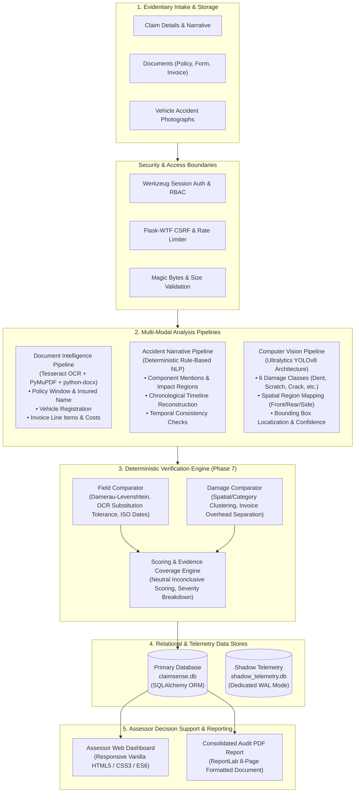
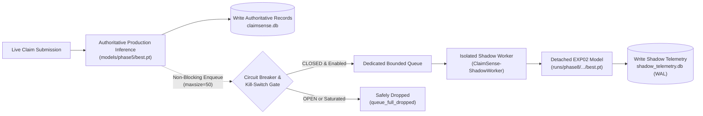

# ClaimSense AI

> **Explainable AI-Assisted Vehicle Insurance Claim Verification & Evidence Cross-Referencing Platform**
> *Academic Decision-Support Prototype &mdash; Final-Year B.Tech Major Project (Session 2026–2027)*

[](https://www.python.org/)
[-black?logo=flask)](https://flask.palletsprojects.com/)
[](https://www.sqlalchemy.org/)
[](https://www.sqlite.org/)
[](https://github.com/ultralytics/ultralytics)
[](https://pytorch.org/)
[-brightgreen)](tests/)
[](#-project-roadmap)

---

> [!IMPORTANT]
> **Academic Scope & Responsible AI Disclaimer:**
> ClaimSense AI is engineered strictly as an **assistive decision-support prototype** for insurance claims examiners and technical evaluators. It assists human assessors by cross-referencing multi-source evidentiary artifacts (official policy schedules, claim submission forms, repair invoices, claimant accident narratives, and vehicle photographs).
> **ClaimSense AI does NOT autonomously approve, adjust, or deny claims, nor does it assert legal proof of insurance fraud.** All algorithmic findings, damage classifications, and consistency scores require human assessor review and validation.

---

## 👥 Project Team & Academic Governance

* **Institution:** ABES Engineering College, Ghaziabad
* **Department:** Department of Computer Science & Engineering
* **Academic Session:** 2026–2027
* **Faculty Supervisor:** Ms. Sonia Lamba, Assistant Professor, Department of CSE

**Project Contributors:**
1. **Ansh Gupta** &mdash; Roll No. 2300320120051
2. **Ankit Yadav** &mdash; Roll No. 2300320120048
3. **Ananya Chauhan** &mdash; Roll No. 2300320120041

---

## 📌 Project Overview

Motor vehicle insurance claim adjudication routinely requires reconciling disparate, heterogeneous, and often contradictory sources of evidence:
* **Structured Policy Records:** Policy validity windows, insured vehicle registration numbers, coverage terms, and named beneficiaries.
* **Intake Claim Forms:** First-party loss descriptions, claimed incident timestamps, location statements, and driver declarations.
* **Repair Shop Documentation:** Garage work estimates, repair invoices, replacement part descriptions, and labor line items.
* **Claimant Accident Narratives:** Free-text descriptions detailing sequence of events, points of physical impact, and claimed damages.
* **Photographic Evidence:** High-resolution vehicle photographs depicting physical impact, paint scratches, dents, and fractures.

In traditional workflows, manual cross-referencing across these silos is labor-intensive, error-prone, and susceptible to cognitive fatigue. Relying on a single automated model (such as an isolated damage classifier or a single OCR tool) introduces severe brittleness: an algorithm cannot discern whether a detected dent existed before the collision or whether a repair shop billed for a bumper that the photograph proves is completely undamaged.

**ClaimSense AI** solves this challenge through an **evidence cross-referencing architecture**. Rather than trusting any single model, ClaimSense AI independently parses documents, detects visual vehicle damage via Computer Vision, reconstructs accident timelines via rule-based NLP, and submits all extracted entities to a **deterministic Cross-Source Verification Engine**. The system generates transparent, explainable consistency scores, highlights discrepancies, and compiles comprehensive audit reports for human claim assessors.

---

## 🏛️ System Architecture



---

## 🚀 Key Feature Modules

### 1. Claim Management & Evidentiary Intake
* **Secure Submission Workflow:** Ingests claimant metadata alongside 4 required evidentiary files: policy document, claim form, repair invoice, and primary vehicle photograph.
* **Deterministic File Validation:** Enforces MIME-type inspection, binary magic-byte verification (`%PDF-`, `\xFF\xD8\xFF`, `\x89PNG`, `PK\x03\x04`), 0-byte upload rejection, and 16 MB request limits.
* **Structured Claim Identification:** Automatically generates tamper-resistant, chronological identifiers (`CLM-YYYYMMDD-XXXX`).
* **Lifecycle State Tracking:** Manages formal claim lifecycle states (`SUBMITTED`, `IN_REVIEW`, `VERIFIED`, `FLAGGED`) with ownership isolation.

### 2. Document Intelligence & OCR Pipeline
* **Multi-Format Parsing:** Ingests native vector PDFs, scanned PDF documents, Microsoft Word documents (`.docx`), and raster images (`.jpg`, `.png`).
* **OCR Preprocessing & Extraction:** Employs Tesseract OCR alongside PyMuPDF (`fitz`), Pillow, and OpenCV image binarization for low-contrast text.
* **Structured Field Provenance:** Extracts and retains provenance metadata for key policyholder attributes:
  * Insured party name and policy number
  * Policy validity coverage window (`start_date` to `end_date`)
  * Vehicle registration plate number
  * Repair invoice line items, component replacement costs, and total repair expenses
* **Document Validation:** Verifies structural document completeness and logs OCR confidence indicators.

### 3. Computer Vision Vehicle Damage Detection
* **YOLO-Based Object Detection:** Employs an Ultralytics YOLOv8 architecture optimized for automotive defect localization.
* **Six Fine-Grained Damage Categories:**
  1. `dent` &mdash; Surface indentations and body panel concavities.
  2. `scratch` &mdash; Linear abrasions and surface paint scuffs.
  3. `crack` &mdash; Hairline fractures and structural splits in plastic/metal bumpers.
  4. `glass shatter` &mdash; Fractured windshields, windows, and light clusters.
  5. `lamp broken` &mdash; Cracked or shattered headlamps, tail lamps, and indicator assemblies.
  6. `tire flat` &mdash; Punctured, deflated, or detached tires and wheels.
* **Spatial Damage Localization:** Bounding boxes are dynamically mapped to vehicle coordinate zones (`front_left`, `front_right`, `center`, `rear_left`, `rear_right`, `roof`, etc.) to facilitate spatial cross-checking.
* **Evidence Visualization:** Renders high-resolution annotated damage overlays with confidence badges and bounding-box coordinates.

### 4. Accident Narrative & Chronological Analysis (NLP)
* **Deterministic Rule-Based NLP:** Extracts entities, physical actions, and vehicle parts from claimant statements without unconstrained generative hallucination.
* **Impact & Damage Extraction:** Identifies claimed points of impact (e.g., "rear-ended at a traffic signal", "left side swiped") and affected components.
* **Chronological Sequence Reconstruction:** Reconstructs the temporal sequence of reported events:
  * Pre-incident travel &rarr; Collision/Impact &rarr; Post-collision actions &rarr; Claim filing.
* **Temporal Consistency Checks:** Flags anomalies such as delayed claim reporting, accident dates preceding policy inception, or post-dated incidents.
* *Scientific Disclosure:* The NLP pipeline is purely rule-based and pattern-driven; it was not trained as a supervised deep-learning NLP model.

### 5. Cross-Source Verification Engine (Phase 7)
The Phase 7 verification engine cross-examines evidence across all upstream modules:
* **Claim vs. Policy:** Verifies claimant identity, policy number, and vehicle registration using string distance algorithms (Damerau-Levenshtein transposition distance) and OCR substitution tables (`0`/`O`, `1`/`I`).
* **Policy Validity vs. Incident Date:** Confirms that the accident timestamp occurred strictly within the active policy validity window.
* **Narrative vs. Computer Vision:** Corroborates damages reported in the claimant's statement against bounding boxes detected by YOLOv8. Applies spatial region clustering and requires a confirmation threshold ($\ge 0.50$ confidence) to declare a visual match.
* **Invoice vs. Damage:** Differentiates genuine physical component replacements from standard workshop labor, paint, and administration overhead.
* **Standardized Finding Classifications:**
  * `MATCH`: Independent evidence sources corroborate the fact.
  * `MISMATCH`: Direct contradiction between evidentiary sources (e.g., mismatched registration plate).
  * `INCONCLUSIVE`: Insufficient or low-confidence evidence to confirm or refute a statement.
  * `NOT_VISUALLY_CONFIRMED`: A reported damage item lacks corresponding bounding-box detections in the photograph.
  * `VISUAL_ONLY_FINDING`: Significant physical vehicle damage detected in the photograph that was omitted from the claimant narrative.
  * `POTENTIAL_DISCREPANCY`: Minor date or nomenclature variances requiring manual review.
* **Evidence Coverage & Consistency Scoring:**
  $$\text{evidence\_coverage\_percentage} = \frac{\text{evaluated\_with\_data}}{\text{total\_comparisons}} \times 100.0$$
  The scoring engine assigns non-punitive neutral weights to inconclusive findings and calculates an overall status:
  * `CONSISTENT`: High cross-source corroboration with no critical mismatches.
  * `REVIEW_REQUIRED`: Unexplained visual damage clusters, uncorroborated parts, or moderate discrepancies.
  * `INSUFFICIENT_EVIDENCE`: Evidentiary coverage is too sparse to perform reliable cross-referencing.

#### Verified Verification API Endpoints
| HTTP Method | Endpoint Route | Description | Auth Required |
|:---:|:---|:---|:---:|
| `POST` | `/api/claims/<claim_id>/verify-cross-source` | Executes deterministic cross-source verification and persists findings | **Yes** |
| `GET` | `/api/claims/<claim_id>/verification` | Retrieves latest verification run, overall status, and consistency score | **Yes** |
| `GET` | `/api/claims/<claim_id>/verification/findings` | Fetches itemized comparison findings with severity ratings and evidence sources | **Yes** |
| `GET` | `/api/claims/<claim_id>/verification/summary` | Returns aggregated metrics, evidence coverage, and assessor recommendations | **Yes** |

### 6. Consolidated PDF Audit Report
* **8-Page Formatted Document:** Rendered via ReportLab with corporate headers, itemized evidence logs, tabular OCR entity summaries, visual damage crops with localized bounding boxes, NLP chronology tables, and Page 7 Cross-Source Verification audit summaries.
* **Official Intake Receipt:** Generates standalone, digitally formatted PDF receipts confirming intake timestamp and SHA-256 hashes of submitted files.

---

## 🔬 AI Model Checkpoints & Provenance

### Authoritative Production Baseline
* **Model Checkpoint:** `models/phase5/best.pt`
* **Cryptographic SHA-256:** `90d489e46ff8521edff88d522f0feffa164ac38a53b84700594c02a69e515565`
* **Training Lineage:** Historically trained for 1 initial epoch on CPU using the CarDD baseline dataset.
* **Operational Status:** **100% AUTHORITATIVE ACTIVE BASELINE**. This model serves all live user and assessor claim evaluation requests.

### Experimental & Domain Adaptation Checkpoints
The following experimental checkpoints were produced during Phase 8 research and verified cryptographically on local disk:

| Model Identifier | Filesystem Checkpoint Location | Cryptographic SHA-256 Digest | Status & Role |
|:---|:---|:---|:---|
| **Session 2** | `runs/phase8/session_2/weights/best.pt` | `2ee0a56749ceba72da863fd3496f080ee06f26409daa4e9588fb69ee149333c5` | Historical intermediate baseline (26 cum. epochs) |
| **Session 3** | `runs/phase8/session_3_1024/weights/best.pt` | `9f0d6e2f4b52eb30f52e989eb199e4155454a50aed485c788258f06aaab61ebc` | High-resolution experiment ($1024 \times 1024$) |
| **Session 4** | `runs/phase8/session_4_training_01/weights/best.pt` | `ea53eee94e508bbb81620b47b2a23c9826341b6b5a6981d9371e476cb9d0594f` | Expanded dataset transfer learning initializer |
| **EXP01** | `runs/phase8/domain_adaptation/exp01_negative_mining/weights/best.pt` | `3ebd2a5c6ed2ca0aa58601d31c7918b95f5a2436fdab5ba34fd214dded366dc1` | Negative daylight mining experiment |
| **EXP02** | `runs/phase8/domain_adaptation/exp02_rare_class/weights/best.pt` | `68e2b58ec7759427808621debc9a8d725a9e4c1fbc57a2102cd239a8ca14f006` | **Quarantined candidate (Unpromoted, Trial Standby)** |
| **EXP03** | `runs/phase8/domain_adaptation/exp03_unified_multiscale/weights/best.pt` | `550fa1c01b9f401f190658b7499ae4f442d9afdf93c72b2c4df00e369f815f01` | Unified multiscale augmentation experiment |

---

## 📈 Training History & Benchmark Evaluation

### 1. Model Training History
Training progression across model development iterations on CarDD data:

| Run Identifier | Training Epochs | Image Resolution | Validation mAP50 | Training Context & Characteristics |
|:---|---:|---:|---:|:---|
| **Initial Smoke Test** | 1 | 640 | *Unranked* | Baseline CPU sanity check (`models/phase5/best.pt`). |
| **Session 1** | 10 additional | 640 | 33.70% | Initial GPU transfer learning on CarDD subset. |
| **Session 2** | 15 additional | 640 | 43.64% | Cumulative 26 epochs; converged on collision damage crops. |
| **Session 3** | 10 | 1024 | 39.03% | High-resolution experiment; high VRAM usage without mAP gain. |
| **Session 4** | 20 | 640 | 44.91% | Fine-tuned from Session 2 on expanded CarDD dataset. |

### 2. Historical Three-Way Test Benchmark
Comparative performance evaluated on the frozen 45-image CarDD test split:

| Evaluation Metric | Production Baseline (`best.pt`) | Session 2 Checkpoint | Session 4 Checkpoint |
|:---|---:|---:|---:|
| **Precision** | 17.03% | 55.00% | **52.72%** |
| **Recall** | 17.35% | 34.87% | **36.60%** |
| **F1-Score** | 17.19% | 42.68% | **43.20%** |
| **mAP50** | 0.12% | 41.17% | **41.05%** |
| **mAP50-95** | 0.03% | 25.69% | **26.12%** |
| **Mean Inference Latency** | 49.18 ms | **25.85 ms** | 27.70 ms |

> [!NOTE]
> **Metric Protocol & Reconciliation Notice:**
> The metrics above represent historical benchmark evaluations on cropped collision images. Confidence curve metrics (calculated across all confidence thresholds down to $\tau=0.001$ for mAP) differ substantially from discrete operational metrics calculated at the production decision threshold ($\tau=0.25$). For full forensic reconciliation, refer to the [Gate P Metrics Integrity Audit](runs/phase8/master_orchestration/gate_p_metrics_integrity_audit.md).

### 3. EXP02 Forensic Evaluation & Critical Limitations
Candidate model **EXP02 (Rare Class Expansion)** was fine-tuned during Phase 8 to address false-positive rates on real-world daylight vehicle walkarounds. Forensic evaluation across Phase 8 benchmarks established:

* **Gate P Offline False-Positive Comparison:** In the Gate P offline forensic comparison across the combined 75-image evaluation cohort (45 CarDD collision test crops + 30 Gate L domain adaptation dev split walkarounds), EXP02 reduced false-positive bounding boxes from **6,503 down to 29 (a 99.55% reduction)** at operational confidence threshold $\tau=0.25$. *This offline forensic comparison was achieved by raising feature activation barriers and does not constitute proof of production readiness or independent generalization.*
* **Limitation 1 &mdash; Zero Structural Crack Recall Across Both Evaluated Cohorts:**
  * **Gate O Frozen Independent Benchmark (44 Images):** **0 out of 6 confirmed crack instances detected (0.0% recall)** on the quarantined `CarDD_Independent_Val_v1` walkaround benchmark (`gate_o_independent_benchmark.md`, `gate_g_class_instance_reconciliation.csv`).
  * **Gate P Combined Forensic Cohort (75 Images):** **0 out of 14 confirmed crack instances detected (0.0% recall)** at operational confidence threshold $\tau=0.25$ ($TP=0, FP=0, FN=14$; source: `gate_p_model_comparison_audited.csv`, `gate_p_metrics_integrity_audit.md`).
* **Limitation 2 &mdash; Gate P Aggregate Operational Metrics:** Evaluated across the combined 75-image ground-truth cohort ($GT=167$ instances) at operational confidence threshold $\tau=0.25$ (IoU $\ge 0.40$), EXP02 produced the following operational metrics (`gate_p_model_comparison_audited.csv`):
  * $\text{TP} = 27$
  * $\text{FP} = 29$
  * $\text{FN} = 140$
  * $\text{GT} = 167$
  * $\text{Precision} = 48.2\%$ (27 / 56)
  * $\text{Recall} = 16.2\%$ (27 / 167)
  * $\text{Micro } F_1 = 0.2422$
  While reflection noise was suppressed, the elevated activation barriers also suppressed genuine low-contrast dents and scratches.
* **Limitation 3 &mdash; Non-Independent Dev Set Bias:** The 30-image domain adaptation Dev set was used for hyperparameter tuning and model selection during Gate N; results on those 30 images cannot be cited as independent validation.
* **Governance Verdict & Shadow Trial Status:** **EXP02 IS NOT PROMOTED TO PRODUCTION.** EXP02 is quarantined and unpromoted; it does not operate in live shadow mode. The live 14-day shadow trial has not started, and the background shadow worker thread is stopped and inactive (manager disabled, `enabled=False`) awaiting explicit executive authorization.

---

## 🗃️ Datasets & Data Governance

ClaimSense AI enforces strict data governance across distinct dataset cohorts to prevent data leakage and benchmark contamination.

### Dataset Cohorts Breakdown
1. **Original CarDD_300:**
   * 300 vehicle damage images (210 train, 45 validation, 45 frozen test).
   * 1,002 annotated damage instances across 6 damage classes.
   * Derived from the official academic CarDD dataset (USTC).
2. **Additional CarDD Image Pool:**
   * 100 authentic images sourced from the unused CarDD `train2017` pool.
   * Class balance: 40 crack, 35 scratch, 25 dent images (173 additional annotated bounding boxes).
3. **Expanded Training Dataset:**
   * 310 cumulative training images (829 instances).
   * 45 validation images (140 instances).
   * 45 frozen test images (148 instances).
4. **Quarantined Independent Validation Benchmark (`CarDD_Independent_Val_v1`):**
   * 44 real-world vehicle images (36 Tier 1 $\ge 800 \times 600$, 8 Tier 2 macro crops).
   * 47 ground-truth damage instances annotated via a strict **dual-blind protocol**.
   * Cryptographically locked under a permanent SHA-256 snapshot (`gate_g_sha256_snapshot.csv`).
5. **Gate L Domain Adaptation Cohort (`CarDD_DomainAdaptation_v1`):**
   * 120 authentic daylight vehicle images with permissive CC-BY / CC0 licensing and de-identification.
   * Distribution: 45 clean negative walkarounds, 25 broken lamp, 25 flat tire, 25 cosmetic damage.
   * Split: 90 training images, 30 development images. Zero overlap with the 44-image frozen benchmark.

### Data Governance & Licensing Standards
* **Privacy & De-Identification:** All acquired imagery undergoes automated EXIF metadata stripping and manual blurring of human faces and visible license plates.
* **Provenance Tracking:** Every image is recorded in cryptographic JSON manifests with source URLs, author attribution, and permissive license types.
* **Physical Image Isolation:** Third-party datasets, raw training images, and trained weights are excluded from Git via `.gitignore`. Team members must acquire datasets according to their respective academic license terms.

---

## ⚖️ Phase 7: Cross-Source Verification Deep Dive

Phase 7 introduced ClaimSense AI's core differentiator: **Intelligent Cross-Source Verification**. Phase 7 is an algorithmic verification and integration phase, not a model training phase.

* **Deterministic Rule Architecture:** Rather than using unpredictable generative models, Phase 7 employs formal deterministic comparison rules (`MATCH`, `MISMATCH`, `NOT_VISUALLY_CONFIRMED`, `VISUAL_ONLY_FINDING`, `INCONCLUSIVE`, `POTENTIAL_DISCREPANCY`).
* **Calibrated Scoring Engine:**
  $$\text{raw\_points} = (N_{\text{match}} \times 1.0) + (N_{\text{visual\_only}} \times 0.60) + (N_{\text{not\_confirmed}} \times 0.70) + (N_{\text{inconclusive}} \times 0.50) + (N_{\text{discrepancy}} \times 0.35)$$
  Neutral credit ($0.50$) is granted to inconclusive findings to prevent artificial score penalization when evidence is legitimately unrecorded.
* **Evidence Completeness Metric:** Tracks the proportion of expected evidentiary fields that contained sufficient data for evaluation, separating consistency from evidentiary coverage.
* **Audit Trail Integration:** Findings are dynamically rendered in the assessor web dashboard and exported as an 8-page consolidated PDF audit report.
* **Testing & Quality Assurance:**
  * Phase 7 dedicated unit and integration suite (`tests/test_phase7_verification.py`): **32/32 tests passed (100%)**.
  * Full repository regression suite across all 11 test modules: **137/137 tests passed (100%)**.

---

## 🏁 Phase 8 Final Status & Gate Summary (Gates A–P)

Phase 8 was conducted under active acquisition specification `v1.1-ACTIVE` across 16 formal engineering gates (Gates A–P).

| Gate | Purpose & Focus Area | Formal Gate Verdict | Summary & Evidence |
|:---:|:---|:---:|:---|
| **Gate A** | Dual-Tier Resolution Specification | **APPROVED** | Established Tier 1 ($\ge 800\times600$) and Tier 2 ($\ge 600\times400$, $\ge 30\%$ area) standards. |
| **Gate B** | Specification Activation | **APPROVED** | Promoted `v1.1-ACTIVE` standard; formally archived legacy drafts. |
| **Gate C** | Dual-Blind Annotation (Batch 1) | **PASS** | 8 macro images annotated; 75.0% consensus; senior examiner adjudicated 2 disputes. |
| **Gate D** | Quarantined Macro Image Certification | **PASS** | Resolution, blur metric, and license compliance verified on all 8 images. |
| **Gate E** | Batch 2 Image Acquisition | **PASS** | 25 attempts evaluated; 21 certified Tier 1 walkaround images accepted (4 rejected) under CC licenses (`batch_02_completion_report.md`). |
| **Gate F** | Dual-Blind Annotation (Batch 2) | **PASS** | 21 images annotated double-blind yielding 23 verified damage instances (81.0% immediate consensus; `gate_f_annotation_report.md`). |
| **Gate G** | Independent Validation Integrity Audit | **LOCKED & CERTIFIED** | 44 images / 47 instances cryptographically locked (`gate_g_sha256_snapshot.csv`). |
| **Gate H** | Multi-Class Benchmark Final Unlock | **PASS** | 100% label pairing ratio verified (36 Tier 1, 8 Tier 2 macro). |
| **Gate I** | Independent Model Benchmark | **COMPLETED** | Benchmarked baseline vs Session 2 vs Session 4 on 44 frozen images. |
| **Gate J** | Forensic Benchmark Metrics Audit | **COMPLETED** | Reconciled metric discrepancies; traced walkaround false alarms to specular reflections. |
| **Gate K** | Domain Adaptation Architecture | **COMPLETED** | Codified strategies for rare class expansion, negative mining, and multiscale training. |
| **Gate L** | Controlled 120-Image Acquisition | **PASS WITH WARNINGS** | 120 images acquired (45 clean, 25 lamp, 25 tire, 25 cosmetic). |
| **Gate M** | Dual-Blind Annotation & Split | **PASS** | 120 images annotated; 90 train / 30 dev split; zero leakage to frozen validation set. |
| **Gate N** | Domain Adaptation Experiments | **PASS** | EXP02 won with 87.0% false-positive reduction on dev split. Checkpoints hashed. |
| **Gate O** | Final Independent Benchmark | **PASS** | Synchronized benchmark on frozen 44 images; proved 100% frozen dataset invariance. |
| **Gate P** | Safety Remediation & Offline Smoke Test | **SMOKE TEST PASSED / CONDITIONAL TRIAL APPROVAL (NOT PROMOTED)** | Remediations implemented; 8/8 safety checks passed; live trial held in standby. |

> [!IMPORTANT]
> **Roadmap Governance Boundary:**
> **Phase 8 officially concludes at Gate P. No Gate Q or subsequent Phase 8 gate exists.**

---

## 🛡️ Gate P Safety Architecture & Shadow Trial Status

Gate P established a hardened, non-blocking shadow architecture for potential evaluation without disrupting live claim operations. This architecture was verified offline only; live shadow inference remains completely inactive.



### 1. Mandatory Pre-Activation Remediations Implemented
1. **Production Singleton Isolation:** In `backend/services/vision/damage_detector.py`, `VehicleDamageDetector.get_instance()` was hardened to ensure that custom model requests return independent, detached instances. Calling EXP02 never overwrites `cls._instance`. Added `get_production_singleton()`.
2. **Bounded Background Queue:** In `backend/services/vision/shadow_worker.py`, replaced unbounded thread spawning with a strictly bounded queue (`queue.Queue(maxsize=50)`) serviced by a single dedicated daemon thread (`ClaimSense-ShadowWorker`).
3. **Graceful Saturation Dropping:** When the queue reaches capacity, shadow tasks are dropped immediately (`queue_full_dropped`) without delaying or blocking synchronous claim processing.
4. **3-State Circuit Breaker:** Implemented `ShadowCircuitBreaker` (`CLOSED` &rarr; `OPEN` &rarr; `HALF_OPEN`) tripping automatically upon high CPU ($>70\%$), high GPU ($>70\%$), latency spikes ($>200$ ms), or 3 consecutive worker errors.
5. **Atomic Filesystem Kill-Switch:** Touching `runs/phase8/shadow_trial/KILL_SWITCH` immediately halts shadow dispatch in $<1$ ms. Deleting the file leaves the system disabled until an operator explicitly re-enables it.
6. **Dedicated WAL Telemetry Database:** Shadow telemetry is strictly isolated in `backend/database/shadow_telemetry.db` configured in SQLite `WAL` mode (`PRAGMA journal_mode=WAL;`) with a 5000 ms busy timeout.
7. **Operational Monitoring CLI Scripts:** Created `scripts/run_daily_shadow_monitor.py` for automated SLA checks and `scripts/extract_adjudication_queue.py` for human review queue extraction.
8. **Controlled Offline Smoke Test:** Successfully executed `scripts/execute_gate_p_offline_smoke_test.py` across 8 approved test images. **8/8 safety checks passed**; verified 0 bytes written to `claimsense.db`.

### 2. Operational Trial Status Disclosures
* **14-Day Live Shadow Trial Status:** **PLANNED BUT NOT STARTED.** The system is in clean standby awaiting explicit executive human authorization.
* **48-Hour Live Pilot Status:** **NOT STARTED.**
* **Shadow Worker State:** The background worker thread is stopped and inactive (manager `enabled=False`). No background shadow processing is running.
* **Adjudication Volume Strategy:** A formal **Low-Volume Waiver** was selected as the preferred operational approach due to low organic intake, but live activation has not been triggered.
* **Offline Smoke Test Distinction:** Passing the offline smoke test confirms technical plumbing and isolation only; it **does not constitute live statistical validation**.
* **Model Status:** `models/phase5/best.pt` remains 100% authoritative. EXP02 is quarantined, unpromoted, and not running in live shadow mode.

---

## 🗺️ Project Roadmap

The formal project roadmap comprises 11 structured phases:

| Phase | Milestone Name | Operational Status | Key Deliverables & Focus |
|:---:|:---|:---:|:---|
| **Phase 1** | Project Foundation | **Completed** | Flask application factory, directory scaffolding, logging, health APIs. |
| **Phase 2** | Claim Management | **Completed** | Intake forms, secure upload handling, Claim ID generator, storage engine. |
| **Phase 3** | Database / Auth / Security | **Completed** | SQLite persistence, SQLAlchemy ORM, Werkzeug auth, PDF intake receipts. |
| **Phase 4** | Document Intelligence / OCR | **Completed** | Tesseract OCR, PyMuPDF, python-docx, entity extraction & provenance. |
| **Phase 5** | Computer Vision | **Implemented** | YOLOv8 vehicle damage detection across 6 classes, bounding-box overlays. |
| **Phase 6** | NLP & Chronological Analysis | **Implemented** | Deterministic narrative parser, component extractor, timeline consistency. |
| **Phase 7** | Cross-Source Verification | **Completed** | Multi-source consistency engine, evidence coverage, 8-page audit PDF. |
| **Phase 8** | Dataset Preparation & Model Training | **Closed at Gate P** | Multi-tier datasets, dual-blind annotation, EXP01–03, Gate P safety hardening. |
| **Phase 9** | Model Evaluation & Optimization | **Completed & Certified** | Controlled retraining (P9-T01/T02), independent CarDD benchmark (+35.8% mAP50, +85.2% precision), crack failure forensics, Category A production model retained, E2E system validation (10/10 workflows, 158 tests passed), closure package. |
| **Phase 10** | Full System Integration & E2E Testing | **Completed in Phase 9.10** | End-to-end multi-modal workflows (10/10), 26 REST APIs verified, security hardening, performance SLAs. |
| **Phase 11** | Deployment, Monitoring & Documentation | **Phase 9.11 Ready** | Production model re-certified, reproducibility guide, academic evidence summary, project owner sign-off. |

---

## 📁 Repository Structure

```text
ClaimSense-AI/
├── backend/                               # Core backend application
│   ├── app.py                             # Flask application factory & blueprint registry
│   ├── config.py                          # Environment configuration & security constraints
│   ├── extensions.py                      # Flask-WTF CSRF and Flask-Limiter instances
│   ├── database/                          # Persistence layer
│   │   ├── db.py                          # SQLAlchemy engine & session lifecycle (default: data/claimsense.db)
│   │   ├── models.py                      # ORM models (User, Claim, Document, VerificationRun, etc.)
│   │   ├── claimsense.db                  # [Local] Primary SQLite DB (when configured at backend/database/)
│   │   └── shadow_telemetry.db            # [Local] Dedicated shadow telemetry database (WAL mode, isolated)
│   ├── routes/                            # Modular REST API endpoints
│   │   ├── auth.py                        # Authentication, registration & profile routes
│   │   ├── claims.py                      # Claims intake, evidence retrieval & verification APIs
│   │   └── health.py                      # Health diagnostics & readiness probes
│   ├── services/                          # Domain service engines
│   │   ├── receipt.py                     # ReportLab PDF receipt & 8-page audit report generator
│   │   ├── ocr/                           # Document intelligence & Tesseract OCR pipeline
│   │   ├── nlp/                           # Deterministic narrative & chronological analyzer
│   │   ├── vision/                        # YOLOv8 damage detection, singleton & shadow worker
│   │   └── verification/                  # Phase 7 Cross-Source Verification engine & rules
│   └── utils/                             # Centralized utilities (security, logging, validators)
├── data/                                  # Default primary database storage (per config.py & .env.example)
│   └── claimsense.db                      # [Default] Configured default primary SQLite database
├── frontend/                              # Responsive assessor web application
│   ├── index.html                         # Single-page assessor dashboard & claim modal
│   ├── app.js                             # Client-side API controller & verification UI renderer
│   └── style.css                          # Modern CSS styling & component design
├── models/                                # Production model checkpoints
│   └── phase5/
│       └── best.pt                        # Authoritative production YOLOv8 checkpoint (SHA-256: 90d489e46...)
├── reports/                               # Generated claim PDFs and verification exports
├── runs/                                  # Research, training, and shadow trial records
│   └── phase8/                            # Phase 8 master orchestration & gate reports
│       ├── master_orchestration/          # Formal Gate A–P reports, metrics & sign-offs
│       ├── domain_adaptation/             # EXP01–EXP03 domain adaptation checkpoints & logs
│       └── shadow_trial/                  # Shadow trial configuration, kill-switch & logs
├── scripts/                               # Operational CLI tools & validation scripts
│   ├── execute_gate_p_offline_smoke_test.py # Gate P offline smoke test execution script
│   ├── run_daily_shadow_monitor.py        # Daily 24-hour shadow telemetry audit script
│   └── extract_adjudication_queue.py      # Script to extract human adjudication cases
├── tests/                                 # Automated regression & integration test suite
│   ├── test_auth.py                       # Authentication & session tests (11 tests)
│   ├── test_claims.py                     # Claim submission & validation tests (9 tests)
│   ├── test_database.py                   # Relational schema tests (4 tests)
│   ├── test_document_processing.py        # Document parsing & OCR tests (13 tests)
│   ├── test_health.py                     # Health diagnostics tests (4 tests)
│   ├── test_ownership_and_receipt.py      # Access control & PDF receipt tests (5 tests)
│   ├── test_phase5_vision.py              # Computer vision & damage detection tests (30 tests)
│   ├── test_phase6_nlp.py                 # NLP narrative & timeline tests (14 tests)
│   ├── test_phase7_verification.py        # Cross-source verification engine tests (32 tests)
│   ├── test_security.py                   # Security, CSRF & rate limit tests (8 tests)
│   └── test_ui_redesign.py                # Dashboard & UI component tests (7 tests)
├── .env.example                           # Safe environment configuration template
├── .gitignore                             # Git ignore rules (binaries, databases, caches excluded)
├── DEVELOPMENT_LOG.md                     # Comprehensive technical development log
├── requirements.txt                       # Python package dependencies
└── README.md                              # Master project documentation
```

---

## 🛠️ Installation, Setup & Execution

### System Prerequisites
* **Operating System:** Windows 10/11, Ubuntu 20.04+, or macOS.
* **Python Runtime:** Python 3.10 to Python 3.13 (Tested on Python 3.13.2 on Windows x86_64).
* **Git:** For version control.
* **Hardware Acceleration (Optional):** NVIDIA GPU with CUDA 11.8+ / 12.8+ for accelerated YOLOv8 inference (CPU inference is fully supported via PyTorch fallback).

### 1. Repository Setup & Virtual Environment
```powershell
# Clone the repository
git clone https://github.com/anshg8252/ClaimSense-AI.git
cd ClaimSense-AI

# Create a clean virtual environment
python -m venv .venv

# Activate the virtual environment (Windows PowerShell)
.\.venv\Scripts\Activate.ps1
# Or on Linux/macOS: source .venv/bin/activate

# Upgrade pip and install dependencies
pip install --upgrade pip
pip install -r requirements.txt
```

### 2. Environment Configuration
Copy the sample environment file to create your local `.env`:
```powershell
Copy-Item .env.example .env
```

Ensure the configuration variables in `.env` are set appropriately for local development:
```ini
# Flask Server Settings
FLASK_APP=backend/app.py
FLASK_ENV=development
FLASK_DEBUG=True
PORT=5001
HOST=127.0.0.1
SECRET_KEY=dev-insecure-secret-key-claimsense-ai-local-only  # Change to strong secret in production

# Upload & File Storage Limits
UPLOAD_FOLDER=uploads
MAX_CONTENT_LENGTH=16777216  # 16 MB maximum request payload

# Database Configuration
DATABASE_PATH=data/claimsense.db  # Default path per config.py / .env.example (or backend/database/claimsense.db)
DATABASE_URL=sqlite:///data/claimsense.db

# LLM Integration (Phase 9 Placeholder)
LLM_PROVIDER=mock
LLM_API_KEY=

# Risk Scoring Thresholds
RISK_THRESHOLD_LOW=30
RISK_THRESHOLD_MEDIUM=60
```
*(Default port is configured to `PORT=5001` to prevent collisions with existing Windows system services).*

### 3. Launching the Backend Application
```powershell
python backend/app.py
```
The Flask development server will boot on `http://127.0.0.1:5001`. Database tables and required upload directories are automatically initialized on startup.

### 4. Accessing the Assessor Web Dashboard
Open any modern web browser and navigate to:
```text
http://127.0.0.1:5001/
```
The web dashboard provides user authentication, claim submission, policy lookup, interactive damage overlays, and the Phase 7 Cross-Source Verification panel.

### 5. Running the Automated Test Suite
Execute the complete automated test suite using Python's standard `unittest` test discovery within the active virtual environment:
```powershell
# Using the active virtual environment Python
python -m unittest discover tests -v
# Or directly via the virtual environment binary:
.\.venv\Scripts\python.exe -m unittest discover tests -v
```
**Current Test Execution Status:** **158 / 158 tests passing (100% pass rate, 0 failures, 0 errors, 1 skipped)** across all 12 test modules.

---

## 📚 Key Governance Reports & Documentation

Comprehensive engineering, audit, and benchmark records across all development phases are maintained directly in the repository:

* **Phase 9 Model Optimization, Retraining & Final Closure Package:**
  * [Phase 9.11 Final Project Closure & Governance Report](runs/phase9/final_closure/PHASE_9_11_FINAL_REPORT.md) &mdash; Master Phase 9 synthesis, closure checklist, and sign-off package.
  * [Phase 9.10 End-to-End System Validation Report](runs/phase9/system_validation/PHASE_9_10_FINAL_REPORT.md) &mdash; 10/10 operational workflows, 26 REST APIs, security controls, and 158/158 test verification.
  * [Phase 9.9 Staging Integration & Compatibility Verification](runs/phase9/staging_integration/PHASE_9_9_FINAL_REPORT.md) &mdash; Read-only staging audit confirming 100% API and model loading compatibility.
  * [Phase 9.8 Final Model Selection & Approval Report](runs/phase9/final_model_decision/PHASE_9_8_FINAL_REPORT.md) &mdash; Authoritative decision: Category A (Retain Existing Production Model).
  * [Phase 9.7 Comparative Analysis & Promotion Readiness](runs/phase9/production_candidate_review/PHASE_9_7_FINAL_REPORT.md) &mdash; Production vs Candidate P9-T02 comparative review.
  * [Phase 9.6 Independent Benchmark Evaluation Report](runs/phase9/independent_evaluation/PHASE_9_6_FINAL_REPORT.md) &mdash; Track A CarDD evaluation (+35.8% mAP50 gain, 0/13 crack recall).
  * [Phase 9.5 Controlled Model Retraining Final Report](runs/phase9/retraining/PHASE_9_5_FINAL_REPORT.md) &mdash; P9-T01 baseline and P9-T02 high-resolution training execution.
  * [Phase 9.4 Training Strategy & Optimization Master Plan](runs/phase9/training_strategy/PHASE_9_4_FINAL_REPORT.md) &mdash; Master experiment matrix and anti-suppression gating policy.
  * [Phase 9.2 Structural Crack Failure Forensics](runs/phase9/crack_investigation/phase9_2_completion_report.md) &mdash; Root-cause diagnosis of hairline crack vanishing and scratch confusion.
  * [Phase 9.0 Master Baseline Audit Completion Report](runs/phase9/baseline_audit/phase9_phase9_0_completion_report.md) &mdash; Environment manifest, dataset inventory, and baseline verification.
  * [Scientific Reproducibility Guide & Runbook](runs/phase9/final_closure/reproducibility_guide.md) &mdash; Standard operating procedure for environment setup, testing, and benchmarks.
  * [Academic Project Evidence Package](runs/phase9/final_closure/academic_evidence_summary.md) &mdash; Factual B.Tech major project academic evidence summary.
  * [Known Issues & Limitations Register](runs/phase9/system_validation/known_issues_register.md) &mdash; Detailed catalog of 7 identified limitations and future scope.
* **Phase 8 Master Closure Package:**
  * [Phase 8 Final Closure Report](runs/phase8/master_orchestration/phase8_final_closure_report.md) &mdash; Master program conclusion and governance record (Gates A–P).
  * [Phase 8 Complete Artifact Index](runs/phase8/master_orchestration/phase8_complete_artifact_index.md) &mdash; Catalog of all 579 Phase 8 files, manifests, and metrics.
  * [Phase 8 Model Status & Technical Limitations](runs/phase8/master_orchestration/phase8_model_status_and_limitations.md) &mdash; Comprehensive analysis of model provenance and limitations.
  * [Phase 8 Project Handover Document](runs/phase8/master_orchestration/phase8_project_handover.md) &mdash; Handover package, runbooks, and transition requirements.
* **Gate P Safety & Smoke Test Documentation:**
  * [Gate P Controlled Offline Smoke Test Report](runs/phase8/master_orchestration/gate_p_offline_smoke_test_report.md) &mdash; 8/8 safety mechanisms offline verification.
  * [Gate P Pre-Activation Remediation Specification](runs/phase8/master_orchestration/gate_p_pre_activation_remediation.md) &mdash; Technical implementation of singleton isolation and bounded queue.
  * [Gate P Metrics Integrity Audit](runs/phase8/master_orchestration/gate_p_metrics_integrity_audit.md) &mdash; Independent read-only metrics audit and confusion matrix reconciliation.
  * [Gate P Final Engineering Sign-Off](runs/phase8/master_orchestration/gate_p_final_engineering_signoff.md) &mdash; Architectural audit and conditional shadow approval.
* **Phase 7 Cross-Source Verification:**
  * [Phase 7 Development & Verification Log](DEVELOPMENT_LOG.md#phase-7-cross-source-verification--intelligent-claim-validation) &mdash; Verification engine rules, test coverage, and calibration logs.
* **Earlier Phase Documentation:**
  * [Phase 4 Completion Report](PHASE_4_COMPLETION_REPORT.md) &mdash; Document intelligence and OCR benchmark evaluation.
  * [Phase 3 Stabilization Report](docs/PHASE_3_STABILIZATION_REPORT.md) &mdash; Security hardening, RBAC, and PDF receipts.

---

## ⚠️ Limitations & Responsible AI Principles

1. **Assistive Decision Support Only:** ClaimSense AI is strictly an investigative aid. Its scores, findings, and detected damage categories must never be treated as autonomous grounds for claim denial or acceptance.
2. **Computer Vision Imperfections:** Bounding-box detection models are sensitive to vehicle orientation, lighting glare, panel reflections, and dirt. Minor scratches and hairline cracks can be missed, while specular highlights can trigger false alarms.
3. **OCR Sensitivity:** Document extraction accuracy depends on scan resolution, lighting, and layout cleanliness. Hand-filled or degraded forms may yield incomplete extractions.
4. **Deterministic Rule Scope:** The rule-based NLP engine operates strictly on recognizable semantic keywords and pattern heuristics; complex metaphorical statements or ambiguous regional expressions may not be captured.
5. **Inconclusive Findings Require Human Judgment:** When evidence sources conflict or are missing, human examiners must inspect original documentation rather than assuming fraudulent intent.
6. **Phase 9 Model Retention & Production Checkpoint Invariance:** Following extensive Phase 9 evaluation on the CarDD independent benchmark, Candidate P9-T02 demonstrated precision gains (+85.2%) but failed the zero-tolerance operational crack recall criterion (0/13 detections at $\tau=0.25$) and exhibited recall regressions on dents and scratches. In accordance with strict governance rules against aggregate metric masking, Candidate P9-T02 was rejected and the verified Phase 5 production baseline (`models/phase5/best.pt`) was officially retained.
7. **EXP02 Model Quarantine & Inactive Trial Status:** Candidate model EXP02 is experimental and unpromoted; it does not operate in live shadow mode. Its 0.0% structural crack recall prevents its deployment for live claim determinations. The live 14-day shadow trial has not been initiated, and the background shadow worker remains completely stopped and disabled awaiting explicit human authorization.

---

## 📄 License & Intellectual Property

This software and its accompanying documentation are developed as a **Final-Year B.Tech Major Project** within the Department of Computer Science & Engineering at **ABES Engineering College, Ghaziabad**.

* **Academic Use:** This repository is maintained for educational, academic research, and technical evaluation purposes.
* **Open Source Licensing:** No formal commercial open-source license is currently granted. Commercial use, public redistribution, or deployment in production insurance environments requires explicit written permission from the project authors and institution.
* **Third-Party Research Datasets:** Research datasets (CarDD, FUNSD, SROIE) remain the intellectual property of their respective creators and are governed by their original academic licenses.
