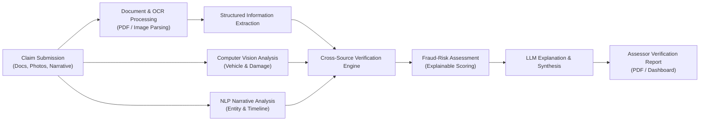

# ClaimSense AI

> **AI-Powered Insurance Claim Verification Using Image & Document Analysis**  
> *Final-Year B.Tech Major Project &mdash; Academic Decision-Support Prototype*

---

> [!IMPORTANT]
> **Academic Scope & Legal Disclaimer:**  
> ClaimSense AI is designed strictly as an academic decision-support prototype to assist human claim assessors by detecting inconsistencies across multi-source evidence (policy records, claim forms, bills, claimant narrative statements, and vehicle images). It is **NOT** an autonomous claim adjudication system and does **NOT** assert or prove legal fraud.

---

## 📌 Project Overview

Motor insurance claim processing often involves reconciling disparate and unstructured data points:
- Official policy schedules
- Submitted claim application forms
- Repair estimates and garage invoices
- First-person claimant accident descriptions
- Photographic evidence of vehicle damage

Manual cross-referencing across these sources is time-consuming and prone to oversight. **ClaimSense AI** provides an explainable verification pipeline that extracts structured entities across documents, performs visual component inspection on vehicle photographs, cross-verifies facts using a deterministic rule engine, computes an explainable risk score (Low / Medium / High), and generates transparent audit summaries for human assessors.

---

## 🏛️ Pipeline Architecture



---

## 📁 Repository Structure

```text
ClaimSense-AI/
├── backend/
│   ├── app.py                     # Flask application factory & server entry point
│   ├── config.py                  # Environment-driven configuration
│   ├── routes/
│   │   ├── __init__.py
│   │   └── health.py              # System health & diagnostic endpoint
│   ├── services/                  # Modular pipeline services
│   │   ├── ocr/                   # Phase 4: OCR & document parsing
│   │   ├── vision/                # Phase 5: Pretrained vehicle damage inspection
│   │   ├── nlp/                   # Phase 6: Narrative analysis & entity extraction
│   │   ├── verification/          # Phase 7: Cross-source consistency rule engine
│   │   ├── risk/                  # Phase 8: Weighted risk scoring (Low/Med/High)
│   │   └── llm/                   # Phase 9: Bounded LLM report explanation
│   ├── database/                  # Phase 3: SQLite schema & ORM models
│   └── utils/
│       ├── __init__.py
│       └── logger.py              # Centralized logging configuration
├── frontend/                      # Assessor Dashboard (Vanilla HTML5 / CSS3 / ES6)
│   ├── index.html                 # Main dashboard UI
│   ├── style.css                  # Modern UI styles
│   └── app.js                     # Health monitoring & frontend controller
├── data/
│   └── sample_claims/             # Benchmark test claims (synthetic data)
├── models/                        # Pretrained model weights/cache
├── uploads/                       # Secured upload storage
├── reports/                       # Generated audit reports
├── tests/                         # Automated unit & integration tests
│   ├── __init__.py
│   └── test_health.py             # Health check test suite
├── .env.example                   # Environment template
├── .gitignore                     # Git ignore rules
├── requirements.txt               # Python package dependencies
├── DEVELOPMENT_LOG.md             # Phase-wise development tracking
└── README.md                      # Project documentation
```

---

## 🛠️ Technology Stack (Phase 1)

| Layer | Technology | Purpose |
|---|---|---|
| **Language** | Python 3.13.2 | Core application language |
| **Backend Framework** | Flask 3.1.3 | REST API and static asset hosting |
| **API Middleware** | Flask-CORS 4.0.2 | Cross-Origin Resource Sharing |
| **Configuration** | python-dotenv 1.2.4 | `.env` environment variable management |
| **Frontend** | HTML5, Modern CSS3, JavaScript (ES6) | Responsive, lightweight assessor UI |
| **Testing** | Python `unittest` | Continuous module verification |

---

## 🚀 Setup & Execution Guide

### Prerequisites
- Python 3.10+ (Tested on **Python 3.13.2** on Windows 11)
- Git

### 1. Clone & Navigate to Repository
```powershell
git clone https://github.com/anshg8252/ClaimSense-AI.git
cd "ClaimSense AI"
```

### 2. Activate Virtual Environment
The virtual environment is located in `.venv`. To activate:
```powershell
# Windows PowerShell
.\.venv\Scripts\Activate.ps1
```
*(If creating anew: `python -m venv .venv` followed by `pip install -r requirements.txt`)*

### 3. Verify Environment Configuration
Copy the template configuration if `.env` is not present:
```powershell
Copy-Item .env.example .env
```

### 4. Run the Backend Server
```powershell
python backend/app.py
```
The server will boot on `http://127.0.0.1:5000`.

### 5. Access the Web Dashboard
Open your browser and navigate to:
```text
http://127.0.0.1:5000/
```

### 6. Run Test Suite
```powershell
python -m unittest discover tests
```

---

## 🔌 API Endpoints (Current)

### `GET /api/health`
Checks backend operational status and environment diagnostics.

**Sample Response (`200 OK`):**
```json
{
  "description": "AI-Powered Insurance Claim Verification Decision-Support Prototype",
  "environment": "development",
  "phase": "Phase 1 - Project Foundation",
  "project": "ClaimSense AI",
  "status": "healthy",
  "timestamp": "2026-10-08T08:43:25.202301+00:00",
  "version": "1.0.0"
}
```

### `POST /api/claims`
Accepts `multipart/form-data` claim submissions including claimant details and multi-source evidence files.

**Request Form Fields:**
- `claimant_name` (string, required)
- `policy_number` (string, required)
- `vehicle_number` (string, required)
- `accident_date` (string `YYYY-MM-DD`, required)
- `claim_description` (string narrative, required)

**Request Files:**
- `policy_document` (file: `.pdf`, `.docx`, `.png`, `.jpg`, `.jpeg`, required)
- `claim_form` (file: `.pdf`, `.docx`, `.png`, `.jpg`, `.jpeg`, required)
- `invoice_document` (file: `.pdf`, `.docx`, `.png`, `.jpg`, `.jpeg`, required)
- `vehicle_image` (file: `.png`, `.jpg`, `.jpeg`, required)

**Sample Response (`201 Created`):**
```json
{
  "success": true,
  "claim_id": "CLM-20261008-A9Z1",
  "message": "Claim submitted successfully",
  "data": {
    "claim_id": "CLM-20261008-A9Z1",
    "claimant_name": "Rajesh Sharma",
    "policy_number": "POL-2024-88391",
    "vehicle_number": "MH-12-DE-4052",
    "accident_date": "2026-09-28",
    "claim_description": "Rear bumper and tail light damaged...",
    "files_count": 4,
    "created_at": "2026-10-08T08:58:12.102941+00:00"
  }
}
```

### `GET /api/claims/<claim_id>`
Fetches registered claim metadata and stored file manifest for a specific Claim ID.

---

## 🗄️ File Storage Architecture

```text
uploads/
└── <claim_id>/
    ├── metadata.json
    ├── documents/
    │   ├── policy_document_<clean_filename>
    │   ├── claim_form_<clean_filename>
    │   └── invoice_document_<clean_filename>
    └── images/
        └── vehicle_image_<clean_filename>
```

---

## 📋 Implementation Roadmap

- [x] **Phase 0:** Project Repository & Technology Audit
- [x] **Phase 1:** Project Foundation, Scaffolding, Flask API, UI Shell & Health Diagnostics
- [x] **Phase 2:** Claim Submission Module (File uploads, validation, Claim ID generation, safe storage)
- [ ] **Phase 3:** Database Architecture (SQLite models for claims, evidence & assessments)
- [ ] **Phase 4:** OCR & Multi-Format Document Processing
- [ ] **Phase 5:** Computer Vision Analysis (Vehicle damage inspection)
- [ ] **Phase 6:** NLP Narrative & Chronology Extraction
- [ ] **Phase 7:** Cross-Source Verification Engine
- [ ] **Phase 8:** Explainable Fraud-Risk Scoring
- [ ] **Phase 9:** LLM Narrative Explanation & Decision-Support Synthesis
- [ ] **Phase 10:** Final Verification Report Generation
- [ ] **Phase 11:** Interactive Dashboard Integration
- [ ] **Phase 12:** End-to-End System Evaluation & Edge-Case Testing
- [ ] **Phase 13:** Academic Project Documentation & Presentation
