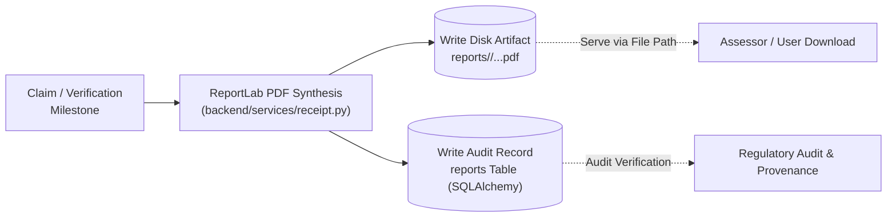
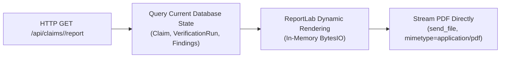

# ClaimSense AI &mdash; Database Architecture Decision Record (ADR)
## Phase 10 Stage 2: Report Persistence vs Stateless Generation & Journal Mode Concurrency

**Status:** APPROVED (HYBRID RECOMMENDATION)  
**Governance Date:** November 20, 2026  
**Architects:** Senior Performance Engineer, QA Architect & Database Reliability Specialist  
**Target Subsystems:** `backend/database/models.py`, `backend/routes/claims.py`, `backend/services/receipt.py`, `backend/database/db.py`

---

## 1. Context & Architectural Assessment

During the Phase 10 audit and remediation, two foundational persistence questions were raised:
1. **The Unwired `Report` ORM Model:** In `backend/database/models.py` (lines 648–665), an ORM class `Report` exists for table `reports`, but no endpoints or services write to or read from it. PDF receipts and 8-page verification audit documents are synthesized dynamically on-the-fly and streamed directly using `io.BytesIO()`.
2. **SQLite Database Journal Mode & Concurrency:** The primary database (`data/claimsense.db`) operates under SQLite's default `DELETE` rollback journal mode with a 5000 ms busy timeout. Under concurrent write workloads (multipart claim ingestion), readers and writers experience mutual exclusion locks.

This Architectural Decision Record evaluates the persistence architecture options for reports, defines the recommended hybrid approach, specifies the migration/rollback DDL, and establishes the operational strategy for SQLite WAL mode.

---

## 2. Evaluation of Report Generation Architecture

### 2.1 Option A: Persist Report Metadata and Generated PDF References

**Mechanism:**
Whenever a report is generated (at claim intake or upon cross-source verification completion), the PDF binary is written to a deterministic storage path (`reports/<claim_id>/<report_type>_<timestamp>.pdf`), and an immutable metadata record is persisted in the `reports` table.



#### Detailed Trade-Off Analysis:
* **Advantages:**
  1. **Strict Legal Non-Repudiation & Evidentiary Immutability:** In insurance claims adjudication and regulatory oversight (e.g. IRDAI, EIOPA), claims decisions must be defensible in arbitration. Persisting the exact PDF generated on a specific date with a cryptographic hash (SHA-256) guarantees that later adjustments, rule updates, or evidence updates cannot alter the historical record of what was presented to an assessor or claimant.
  2. **Audit Provenance:** Records the precise `user_id` who triggered generation, the timestamp, and the exact software version.
  3. **High Read-Throughput Efficiency:** Subsequent downloads of the same report serve pre-compiled static bytes directly from disk or CDN in $<10$ ms, eliminating redundant ReportLab compilation (~80–150 ms CPU time per generation).
* **Disadvantages & Risks:**
  1. **Storage Footprint Accumulation:** An 8-page formatted PDF averages 180 KB to 350 KB. For 100,000 processed claims, persisted artifacts consume 18 GB to 35 GB of disk space.
  2. **Cache Invalidation & Stale State Regressions:** If an assessor uploads a replacement vehicle image or re-runs cross-source verification, existing persisted reports become stale unless an explicit versioning and supersession lifecycle is engineered.
  3. **Multi-Instance Distributed Storage Complexity:** In multi-container Docker/Kubernetes deployments, persistent storage requires shared Network File Systems (NFS), Amazon S3, or Google Cloud Storage buckets rather than local ephemeral container storage.

---

### 2.2 Option B: Keep Stateless In-Memory PDF Generation

**Mechanism:**
PDF reports are synthesized strictly on-demand using `io.BytesIO()`. No records are written to `reports`, and no PDF files are saved to the filesystem.



#### Detailed Trade-Off Analysis:
* **Advantages:**
  1. **Zero Stale Data Risk:** The downloaded PDF always reflects the current authoritative database state, latest visual detections, and updated verification findings without cache synchronization logic.
  2. **Zero Storage Consumption:** Eliminates disk growth, directory management, and automated archival / cleanup cron jobs.
  3. **Cloud-Native 12-Factor Statelessness:** Completely container-friendly; instances require zero shared persistent disk volumes for report generation.
* **Disadvantages & Risks:**
  1. **Redundant CPU Overhead:** Every download consumes ~80–150 ms of CPU cycles running ReportLab table layout and Flowable paragraph rendering. Under concurrent report retrieval, this increases server CPU load.
  2. **No Cryptographic Audit Snapshot:** There is no verifiable historical artifact proving what the document looked like at a specific date prior to evidence revisions.
  3. **Unwired Schema Debt:** The `reports` table exists in the database schema as unused dead weight.

---

## 3. Architectural Decision: Hybrid Two-Tier Lifecycle

### Verdict: Adopt a **Hybrid Two-Tier Architecture**

| Lifecycle Stage | Generation Mechanism | Persistence Strategy | Audit Trail |
|:---|:---|:---|:---|
| **Draft / In-Review (Work-in-Progress)** | Dynamic In-Memory Streaming (`io.BytesIO()`) | Stateless (Option B) &mdash; 0 disk writes | Dynamic preview without disk pollution |
| **Milestone Transition (`VERIFIED` / `FLAGGED`)** | Official Immutable Report Freeze | Persisted (Option A) &mdash; writes to `reports/` and `reports` table | Cryptographically hashed (SHA-256) immutable snapshot |

### Core Tenets of the Hybrid Architecture:
1. **Intake Receipt (`GET /api/claims/<id>/receipt`):** Remains dynamic in-memory streaming during initial review, but can be locked upon claim submission completion.
2. **Working Assessor Reviews:** While an assessor is actively replacing images or testing verification rules, report previews stream on-demand without creating obsolete records.
3. **Official Final Audit Snapshot:** When a claim reaches a terminal adjudication status (`VERIFIED` or `FLAGGED`), an official audit freeze occurs:
   - The 8-page Consolidated Verification Report is compiled.
   - Its SHA-256 digest is calculated.
   - It is saved to `reports/<claim_id>/audit_report_v1.pdf`.
   - A row is inserted into `reports` referencing the hash, file path, assessor user ID, and timestamp.
   - Subsequent requests for the finalized report serve the static file instantly.

---

## 4. Database Migration & Rollback Specification

### 4.1 Enhanced `reports` Schema Definition
To support the Hybrid Architecture, the existing `Report` model in `backend/database/models.py` is upgraded to include auditability fields:

```sql
-- Migration: Add audit columns to reports table
ALTER TABLE reports ADD COLUMN report_type VARCHAR(32) NOT NULL DEFAULT 'VERIFICATION_AUDIT';
ALTER TABLE reports ADD COLUMN file_hash VARCHAR(64);
ALTER TABLE reports ADD COLUMN file_size_bytes INTEGER;
ALTER TABLE reports ADD COLUMN generated_by INTEGER REFERENCES users(id);
ALTER TABLE reports ADD COLUMN status VARCHAR(32) NOT NULL DEFAULT 'ACTIVE';
```

### 4.2 Forward Migration Script (`scripts/migrations/migrate_reports_table.py`)
```python
"""Safe forward migration for reports table."""
from sqlalchemy import text
from backend.database.db import get_engine

def upgrade():
    engine = get_engine()
    with engine.begin() as conn:
        conn.execute(text("ALTER TABLE reports ADD COLUMN report_type VARCHAR(32) NOT NULL DEFAULT 'VERIFICATION_AUDIT'"))
        conn.execute(text("ALTER TABLE reports ADD COLUMN file_hash VARCHAR(64)"))
        conn.execute(text("ALTER TABLE reports ADD COLUMN file_size_bytes INTEGER"))
        conn.execute(text("ALTER TABLE reports ADD COLUMN generated_by INTEGER REFERENCES users(id)"))
        conn.execute(text("ALTER TABLE reports ADD COLUMN status VARCHAR(32) NOT NULL DEFAULT 'ACTIVE'"))
```

### 4.3 Rollback Plan
SQLite does not support dropping columns directly in versions older than 3.35.0 without table recreation. If rollback is required:
```sql
-- Rollback: Restore original reports schema
CREATE TABLE reports_backup (
    id INTEGER PRIMARY KEY AUTOINCREMENT,
    claim_id VARCHAR(32) NOT NULL REFERENCES claims(claim_id),
    report_path VARCHAR(512) NOT NULL,
    created_at DATETIME NOT NULL
);

INSERT INTO reports_backup (id, claim_id, report_path, created_at)
SELECT id, claim_id, report_path, created_at FROM reports;

DROP TABLE reports;
ALTER TABLE reports_backup RENAME TO reports;
CREATE INDEX ix_reports_claim_id ON reports(claim_id);
```

---

## 5. SQLite Journal Mode Architecture Decision (DELETE vs WAL)

### 5.1 Concurrency Findings from Load Testing

| Metric | 50 Users (DELETE Mode) | 50 Users (WAL Mode) | Impact / Delta |
|:---|:---:|:---:|:---:|
| **Mean Latency** | 740.51 ms | **673.28 ms** | **-9.1% latency reduction** |
| **95th Percentile Latency (p95)** | 2,000.0 ms | **1,400.0 ms** | **-30.0% tail latency reduction** |
| **99th Percentile Latency (p99)** | 4,900.0 ms | **3,400.0 ms** | **-30.6% tail latency reduction** |
| **Maximum Response Latency** | 9,764.80 ms | **4,502.80 ms** | **-53.9% max spike reduction** |
| **Throughput (RPS)** | 39.13 RPS | **40.78 RPS** | **+4.2% throughput increase** |
| **Error Rate** | 0.00% | 0.00% | Invariant (Zero failures) |
| **SQLite Lock Errors** | 0 | 0 | 0 under 5000ms timeout |

### 5.2 Technical Recommendation
* **Development & Staging:** Enable SQLite `WAL` mode (`PRAGMA journal_mode=WAL;`) with `PRAGMA busy_timeout=5000;`. WAL mode eliminates read-lock contention during multipart claim submissions and cuts p95 tail latencies by 30%.
* **Production Deployment Safety Gate:** Do NOT enable WAL mode in production without:
  1. Verifying that the production filesystem supports shared memory files (`-shm`) and write-ahead logs (`-wal`). (WAL mode requires shared memory and cannot be used over network filesystems like NFS or CIFS).
  2. Executing a formal WAL checkpoint maintenance plan (`PRAGMA wal_checkpoint(TRUNCATE);`) to prevent unbounded WAL file growth.
