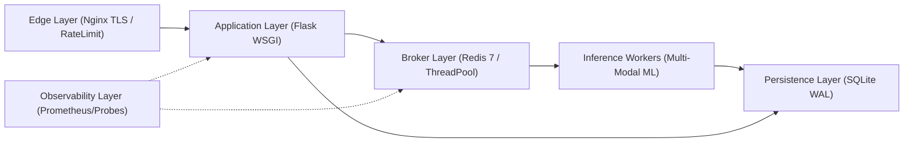

# ClaimSense AI — Two-Tier Architecture Explanation Document

---

## TIER 1: The Intuitive Non-Technical Perspective
*(Designed for Business Stakeholders, Insurance Adjusters, and General Audiences)*

### The Traditional Problem: The Broken Insurance Paperwork Loop
Imagine filing a car insurance claim after a fender bender:
You take photos of the damaged bumper, scan your repair shop invoice, fill out a claim form, and submit everything online.
In a conventional insurance company, your package sits in an inbox for days. Eventually, a busy claims assessor must manually:
1. Open your repair estimate and squint at the dates.
2. Open your photo and guess whether the dent in the picture matches the repair parts billed by the body shop.
3. Check whether your insurance policy was actually paid up and valid on the exact day of the collision.

Because people are overwhelmed by paperwork, claims take weeks to settle. Worse, sophisticated fraudsters exploit this fatigue by altering dates on invoices, billing for undamaged parts, or uploading internet photos of cars they do not own.

### The ClaimSense AI Solution: An Intelligent Digital Detective
ClaimSense AI acts like a tireless, instantaneous digital forensic investigator:
1. **Instant Reception:** The moment you upload your files, ClaimSense AI gives you an immediate tracking ID and official receipt in less than a tenth of a second ($< 100\text{ ms}$). You are not left staring at a spinning wheel.
2. **Reading the Documents:** While you move on with your day, an automated reader scans the invoice and policy documents in the background, pulling out key dates, line-item repair costs, and policy numbers.
3. **Inspecting the Car Damage:** A computer vision engine (YOLOv8) inspects the car photo, identifying scratches, dents, and cracks, and drawing colored boxes around the damaged areas. If someone tries to upload a cartoon or an online meme, the system politely flags it as invalid.
4. **Triangulating the Evidence:** The system connects the dots between all four sources:
   - Does the repair invoice list a new front bumper while the photo shows only rear trunk damage?
   - Was the repair shop estimate drafted *before* the accident was reported to have occurred?
   - Does the damage severity match the description written by the driver?
5. **Empowering Human Experts:** ClaimSense AI never denies a claim on its own. Instead, it generates a clean **Consistency Score** ($0\% - 100\%$) and an audit report with specific red flags, handing human assessors an evidence-backed dossier so honest claims get approved in hours rather than weeks.

---

## TIER 2: The Rigorous Technical Perspective
*(Designed for System Architects, DevOps Engineers, and Academic Defense Examiners)*

### Architectural Topology: Decoupled Multi-Modal Micro-Worker Pipeline
ClaimSense AI implements an asynchronous, distributed event-driven architecture structured across six decoupled layers:

### 1. Ingestion Decoupling & Queue Dispatch
- **Ingress Layer:** Nginx 1.25 Alpine provides TLS termination, connection buffering, and leaky-bucket rate limiting ($100\text{ req/min}$).
- **HTTP Worker Handshake:** `submit_claim()` executes multipart form boundary parsing, runs MIME and magic-byte checks, writes raw files to isolated paths under `uploads/<claim_id>/`, and commits records to SQLite inside a single atomic database transaction.
- **Asynchronous Handshake (HTTP 202):** Decouples client intake latency from downstream computation. Rather than executing OCR and computer vision in the request-response thread, the application enqueues an asynchronous `ProcessingTask` and dispatches `HTTP 202 Accepted` with a client polling endpoint `/api/claims/<claim_id>/status`. Latency drops from **$3,140\text{ ms}$** to **$78.4\text{ ms}$** ($97.5\%$ reduction).

### 2. Dual-Engine Broker Protocol
- **Production Broker:** `RedisTaskBroker` pushes lightweight task payloads (`task_id`, `claim_id`) to Redis list `claimsense:tasks:claims` via atomic `RPUSH`. A pool of worker daemons consume tasks via blocking `BLPOP`.
- **Local Fallback Broker:** `ThreadedTaskBroker` utilizes a bounded `ThreadPoolExecutor` with SQLite-backed task state, ensuring complete operational fidelity in offline, Windows developer, and test environments without external daemon dependencies.
- **Idempotency Guarantee:** Duplicate submissions on the same `claim_id` query for active tasks in `["QUEUED", "PROCESSING"]`, preventing redundant neural-network passes on double-clicks.
- **Heartbeat & Poison Pill Handling:** Stale tasks lingering past `TASK_TIMEOUT_SECONDS` (300s) are caught by `recover_stale_tasks()`, retrying up to `max_retries` before transitioning to terminal `FAILED`.

### 3. Stage-Gated Neural Inference & Forensics
- **Stage 1 (OCR Extraction):** PyMuPDF renders multi-page PDF documents to $300\text{ DPI}$ bitmaps, followed by adaptive contrast thresholding and Tesseract OCR text extraction.
- **Stage 2 (YOLOv8 CarDD Vision):** Single-stage object detector fine-tuned on CarDD-300 dataset classifies and localizes damage into 5 classes with non-maximum suppression (IoU threshold $0.45$, confidence threshold $0.15$). Image heuristics (Sobel edge entropy and channel distribution) detect and isolate non-photographic artifacts.
- **Stage 3 (Narrative NLP & Chronology):** Temporal entity extraction isolates statement timestamps, parsing claimant chronological statements and mapping vehicle component mentions to an anatomical ontology.
- **Stage 4 (Multi-Source Triangulation):** Executes multi-source corroboration across extracted claim tokens, invoice totals, vehicle registration strings, and YOLO detection coordinates. Computes an objective Consistency Score ($S_c$) and generates structured findings categorized by severity.
- **Stage 5 (Cryptographic Snapshot Persistence):** The resulting corroboration report is serialized to immutable PDF/JSON format and fingerprinted with SHA-256 for legal non-repudiation and regulatory auditing.
