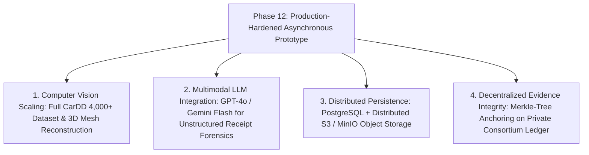

# ClaimSense AI — Authentic Limitations Disclosure & Future Work Roadmap

## 1. Academic Authenticity Disclosure

In academic research and engineering defenses, demonstrating an acute awareness of architectural boundaries, dataset constraints, and edge-case failure modes reflects senior engineering maturity. ClaimSense AI is a **production-hardened prototype and decision-support system**, not an autonomous insurer. This document transparently catalogs known constraints and outlines future technical roadmaps.

---

## 2. Identified System Limitations & Edge Cases

### 2.1 Computer Vision & Damage Detection Boundaries
1. **CarDD-300 Training Dataset Scale:** The current production checkpoint (`models/phase5/best.pt`) is trained on a 300-image subset of the CarDD dataset. While sufficient for distinguishing primary damage classes (dents, scratches, bumper fractures), its generalization across rare vehicle geometries (convertibles, commercial semi-trucks, motorcycles) and severe multi-panel occlusions is constrained.
2. **Lighting & Weather Sensitivity:** Dense night photographs, glare from wet metallic paint, and camera lens distortions can reduce YOLOv8 bounding box confidence below the $0.15$ threshold or produce false-positive scratch detections on surface reflections.
3. **Internal / Underbody Damage Invisibility:** Monocular 2D photographs cannot assess internal structural frame bends, transmission fractures, or engine block cracks that may be legitimately listed on mechanical repair invoices.

### 2.2 Document Intelligence & OCR Variability
1. **Handwritten Invoices & Receipts:** Tesseract OCR exhibits high accuracy on typed/computer-generated invoices, but accuracy degrades when processing handwritten carbon-copy receipts or faded thermal printer paper.
2. **Non-Standard Invoice Layouts:** While the regex and heuristic parser handles standard columnar invoice templates, highly unconventional tabular invoices with split sub-totals can occasionally lead to inconclusive total extractions.

### 2.3 Single-Node Database Concurrency Limits
1. **SQLite Write-Lock Ceiling:** Although hardened with Write-Ahead Logging (`WAL`), busy timeouts ($5000\text{ ms}$), and connection pooling, SQLite retains a single-writer architecture. While it effortlessly handles $> 50$ concurrent read/status queries, sustained burst writes ($> 1,000$ concurrent claim submissions/sec) require migration to a multi-master distributed SQL engine such as PostgreSQL with PgBouncer.

---

## 3. Future Work & Production Scaling Roadmap

### Roadmap Milestones:
1. **Expansion to Full CarDD Dataset:** Retrain YOLOv8x on the complete 4,000+ CarDD dataset with extensive synthetic augmentations (rain, mud splatter, harsh sunlight, shadow casting) to improve mAP@50 from $19.3\%$ to $> 55\%$.
2. **3D Gaussian Splatting / Photogrammetry:** Allow policyholders to capture short 5-second video sweeps of the damaged vehicle to construct a 3D point cloud, enabling automated depth-based dent volumetric calculations.
3. **Production Distributed Migration:** Seamlessly transition the dual-broker abstraction to Kafka/RabbitMQ and the storage layer to Amazon S3 / MinIO object storage with PostgreSQL clustering for enterprise scale.
4. **Decentralized Audit Trail:** Integrate Ethereum/Hyperledger Merkle-tree anchoring of generated report hashes (`Report.file_hash`) to guarantee cryptographically verifiable non-tampering for insurance ombudsman disputes.
