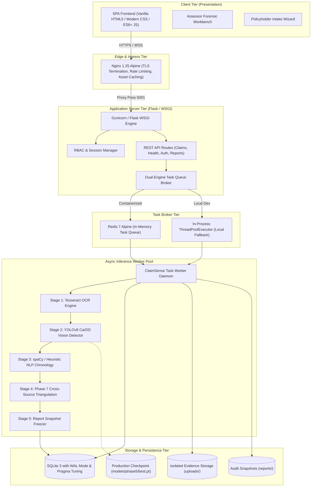

# ClaimSense AI — Comprehensive System Architecture Document
## Academic Major Project Technical Specification

---

## 1. System Vision & Problem Formulation

Insurance claim fraud, manual processing bottlenecks, and uncorroborated documentation cost the global motor insurance industry upwards of \$40 billion annually. Traditional claim assessment relies heavily on manual inspections by human assessors, creating turnaround delays of 7 to 21 days and leaving insurers vulnerable to:
1. **Document Fabrication:** Tampered invoices, mismatched policy schedules, and synthetic loss estimates.
2. **Exaggerated / Unrelated Damage:** Submitting pre-existing vehicular damage or photos harvested from online image repositories.
3. **Chronological Inconsistencies:** Discrepancies between claimant narrative statements, workshop estimate dates, and incident reports.

**ClaimSense AI** is an end-to-end decision-support prototype engineered to automate multi-modal claim evidence corroboration. It ingests official policy schedules, claim forms, repair estimates/invoices, and photographic accident evidence, subjecting them to automated cross-source triangulation.

---

## 2. Multi-Tier Distributed Architecture

---

## 3. Subsystem Breakdown

### 3.1 Ingestion & Validation Subsystem
- **Multipart Form Parser:** Enforces file extension whitelists (`.pdf`, `.png`, `.jpg`, `.jpeg`), zero-byte rejection, MIME type validation, and file magic byte signature checks.
- **Path Sanitization:** `sanitize_and_resolve_path()` prevents directory traversal (`../`) attacks by asserting that all stored files reside strictly within their designated claim subdirectories.
- **Tenant Isolation:** Every claim is explicitly bound to `user_id`. Claims cannot be read, queried, or modified across tenants without explicit assessor or admin credentials.

### 3.2 Dual-Engine Asynchronous Task Queue
- **Primary Broker (Redis 7):** Operates via atomic Redis list operations (`RPUSH` / `BLPOP`). Used in multi-container Docker deployments to decouple ingestion web heads from compute-heavy worker nodes.
- **Secondary Broker (In-Process ThreadPoolExecutor):** Provides native zero-dependency asynchronous processing for Windows/macOS local developer workstations and self-contained pytest runs without requiring external daemons.
- **Idempotency Protection:** Detects active tasks in `QUEUED` or `PROCESSING` state for the requested `claim_id`, suppressing double-click duplicate processing.
- **Stale Task Auto-Recovery:** Detects orphaned jobs exceeding heartbeat thresholds (default: 300s) and automatically retries or marks them `FAILED`.

### 3.3 Multi-Modal Machine Learning & Inference Pipeline
1. **Document OCR (Tesseract / PyMuPDF):** Extracts raw text, metadata, invoice line items, dates, and currency totals from PDF/scanned documents.
2. **Computer Vision (YOLOv8 CarDD):** Detects vehicle damage classes (`scratch`, `dent`, `crack`, `tear`, `shatter`) using custom-trained weights (`models/phase5/best.pt`) on the CarDD dataset. Performs synthetic graphic rejection to prevent clip-art or downloaded stock photo fraud.
3. **Narrative NLP & Chronology:** Analyzes claimant statements to extract incident timestamps, collision mechanics, damaged vehicle components, and severity descriptors.
4. **Cross-Source Triangulation Engine:** Cross-references stated damages against visual YOLO detections, invoice repair items against visual damage locations, and accident dates against invoice dates to generate an objective **Consistency Score** ($0.0\% - 100.0\%$).

---

## 4. Database Schema Architecture

The persistence model is implemented using SQLAlchemy ORM over SQLite 3 configured in Write-Ahead Logging (`PRAGMA journal_mode=WAL`) with a 5000ms busy timeout:

| Table Name | Primary Purpose | Key Fields |
| :--- | :--- | :--- |
| `users` | Role-based authentication | `id`, `username`, `password_hash`, `role`, `is_active` |
| `claims` | Central claim registry | `claim_id`, `user_id`, `policy_number`, `vehicle_number`, `status` |
| `documents` | Evidentiary PDF/scan files | `id`, `claim_id`, `document_type`, `file_path`, `file_size` |
| `claim_images` | Evidentiary vehicle photos | `image_id`, `claim_id`, `file_path`, `file_extension` |
| `extracted_document_data` | OCR text & parsed fields | `id`, `claim_id`, `field_name`, `field_value`, `confidence` |
| `vehicle_damage_analyses` | YOLOv8 visual detection records | `id`, `claim_id`, `total_detections`, `max_confidence` |
| `verification_runs` | Forensic triangulation snapshots | `id`, `claim_id`, `overall_status`, `consistency_score` |
| `verification_findings` | Granular discrepancy items | `id`, `run_id`, `category`, `severity`, `description` |
| `reports` | Immutable audit snapshot metadata | `id`, `claim_id`, `report_path`, `file_hash`, `status` |
| `processing_tasks` | Asynchronous task queue states | `task_id`, `claim_id`, `status`, `current_stage`, `progress_percent` |
