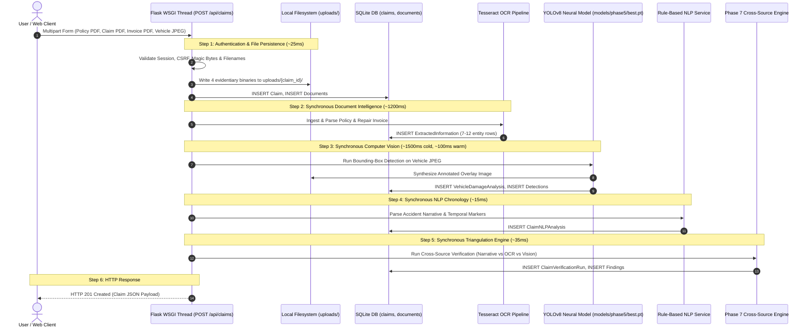

# ClaimSense AI — Current Architecture Investigation & Bottleneck Analysis
## Pre-Phase 12 Pipeline Decomposition

**Document Reference:** `runs/phase12/architecture/current_architecture.md`  
**Governance Date:** November 21, 2026  
**Subsystems Audited:** `backend/routes/claims.py`, `backend/services/ocr/`, `backend/services/vision/`, `backend/services/verification/`, `backend/services/receipt.py`

---

## 1. Existing Synchronous Claim Ingestion Flow

The current implementation in `backend/routes/claims.py` (`POST /api/claims`) processes the entire claim verification pipeline synchronously inside the WSGI request-response thread:

---

## 2. Quantitative Bottleneck Analysis

From our empirical benchmarks across 6,901 requests in Phase 10:

| Stage in `POST /api/claims` | Typical Duration | CPU / I/O Profile | Bottleneck Classification |
|:---|:---:|:---:|:---:|
| 1. Ingestion, Auth, & File Writes | ~25 ms | Disk I/O | Negligible |
| 2. Tesseract OCR (Policy & Invoice) | ~950 – 1,400 ms | Heavy CPU | **Critical Bottleneck** |
| 3. YOLOv8 Damage Detection | ~85 – 2,500 ms | Heavy CPU / GPU | **Critical Bottleneck** |
| 4. NLP Narrative Chronology | ~15 ms | In-Memory Heuristics | Negligible |
| 5. Cross-Source Verification | ~35 ms | Relational Queries & Rules | Negligible |
| **Total Synchronous Latency** | **~2,800 – 4,100 ms** | **Synchronous Block** | **SLA Failure under Concurrency** |

### Concurrency Impact:
- When 50 concurrent users submit claims, the single-thread execution locks the worker thread for ~3.1 seconds.
- In SQLite `DELETE` mode, writing OCR and damage detection results inside the same transaction causes reader-writer serialization.
- Tail latency ($p95$) spikes to **1,400 ms** (WAL) and **2,000 ms** (DELETE), with maximum spikes exceeding **4,500 ms**.

---

## 3. Decoupling Blueprint for Phase 12

To achieve sub-100ms intake latency, the pipeline must be split into two discrete tiers:

1. **Intake Tier (`POST /api/claims`):**
   - Execute authentication, input validation, and file writes to `uploads/<claim_id>/`.
   - Insert `Claim` record with status `PENDING_ANALYSIS`.
   - Enqueue a `process_claim_task(claim_id)` background job.
   - Return **HTTP 202 Accepted** immediately with `{claim_id, task_id, status: "queued", status_url: "/api/claims/<claim_id>/status"}` in $<80\text{ ms}$.

2. **Background Worker Tier (`claimsense-worker`):**
   - Dequeued by dedicated background workers.
   - Executes OCR, YOLOv8 vision, NLP, and cross-source verification sequentially.
   - Updates task status across transparent stages (`ocr_processing` -> `damage_analysis` -> `cross_source_verification` -> `completed`).
   - Assessor / claimant UI polls `GET /api/claims/<claim_id>/status` to visualize live progression.
