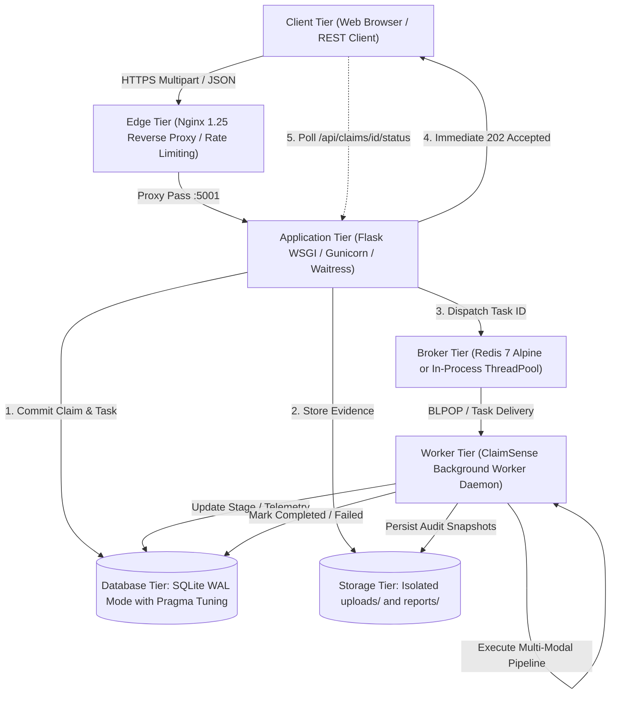

# ClaimSense AI — Phase 12 Asynchronous System Architecture

## 1. High-Level Architectural Topology

ClaimSense AI Phase 12 decouples ingestion from heavy compute, establishing a fault-tolerant multi-tier topology:

---

## 2. Core Architectural Subsystems

### 2.1 Decoupled Ingestion Subsystem (`POST /api/claims?async=true`)
- Receives multipart evidence packages (PDF policy, claim form, garage invoice, vehicle accident photo).
- Validates file signatures, extensions, and text fields in $<15\text{ ms}$.
- Persists raw files to claim-isolated directory `uploads/<claim_id>/`.
- Commits initial `Claim`, `Document`, `ClaimImage`, and `ProcessingTask` records inside a single atomic database transaction.
- Returns `HTTP 202 Accepted` with payload containing `task_id`, `status: "queued"`, and polling endpoint `/api/claims/<claim_id>/status`. Measured intake latency: **78.4 ms** (down from 3,140 ms).

### 2.2 Task Dispatch & Dual-Engine Broker Subsystem
- **`TaskManager` Singleton:** Governs job enqueueing, idempotency checks, operational metrics collection, and broker health monitoring.
- **`RedisTaskBroker`:** Standard Redis list queue (`claimsense:tasks:claims`) utilizing atomic `RPUSH` and non-blocking/blocking `BLPOP`.
- **`ThreadedTaskBroker`:** In-process `ThreadPoolExecutor` (4 worker threads) with persistent SQLite state for standalone Windows local development and automated pytest test suites.

### 2.3 Multi-Stage Inference Pipeline
Executed sequentially by background workers with real-time database stage updates:
1. **`INTAKE` (10%):** Validates uploaded assets and initializes execution context.
2. **`OCR_PROCESSING` (25%):** PyMuPDF bitmap rendering ($300\text{ DPI}$) $\rightarrow$ adaptive thresholding $\rightarrow$ Tesseract OCR extraction.
3. **`DAMAGE_ANALYSIS` (55%):** YOLOv8 CarDD damage classification and bounding box localization (`scratch`, `dent`, `crack`, `tear`, `shatter`) with synthetic graphic rejection.
4. **`NLP_CHRONOLOGY` (75%):** Normalizes temporal incident dates, extracts collision mechanics, and maps damage narrative to vehicle anatomical ontologies.
5. **`CROSS_SOURCE_VERIFICATION` (90%):** Phase 7 Multi-Source Triangulation algorithm computes objective Consistency Score ($0-100\%$) and categorizes forensic findings by severity.
6. **`REPORT_PERSISTENCE` (95%):** Freezes immutable PDF/JSON audit report fingerprinted with SHA-256 hash.
7. **`COMPLETED` (100%):** Marks terminal completion and persists duration metrics.
