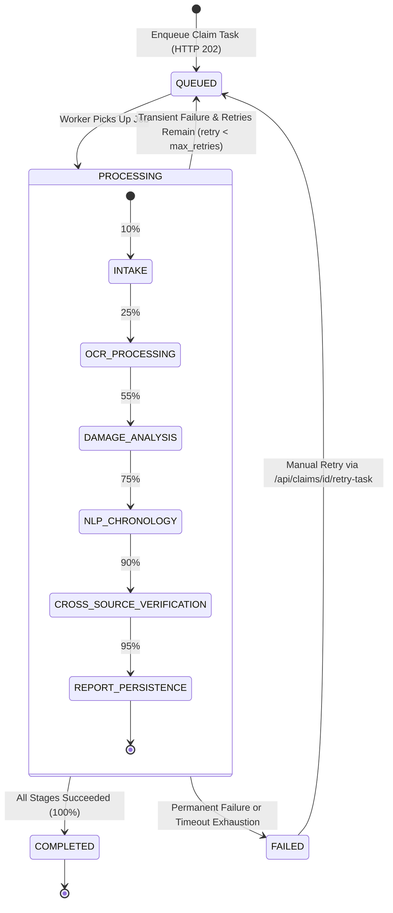

# ClaimSense AI — Phase 12 Task Lifecycle & State Machine Specification

## 1. Task State Machine Diagram

---

## 2. Valid State Transitions & Invariants

| From State | Allowed To State | Trigger / Condition | Invariant Guaranteed |
| :--- | :--- | :--- | :--- |
| **`[*]`** | **`QUEUED`** | Initial claim intake or manual retry | Task record minted; `progress_percent=5` |
| **`QUEUED`** | **`PROCESSING`** | Worker thread/process claims job | `started_at` timestamp recorded; worker ID stamped |
| **`PROCESSING`**| **`PROCESSING`** | Intermediate stage updates | Monotonically increasing progress percent ($10 \rightarrow 95$) |
| **`PROCESSING`**| **`COMPLETED`** | Terminal verification and report frozen | `completed_at` set; `progress_percent=100`; cannot revert |
| **`PROCESSING`**| **`QUEUED`** | Auto-recovery of stale heartbeat | `retry_count` incremented; stage reset to `INTAKE` |
| **`PROCESSING`**| **`FAILED`** | Unrecoverable error or max retries exceeded | `error_code` and sanitized `error_message` persisted |
| **`FAILED`** | **`QUEUED`** | Explicit call to `POST /retry-task` | Re-evaluated by worker; resets failure status |

---

## 3. Terminal State Immutability

Once a task transitions to **`COMPLETED`**, subsequent task submission calls on the same `claim_id` return the existing task without altering its completed state. Under no circumstances can a completed claim be rolled back to `QUEUED` or `PROCESSING` by background workers.
