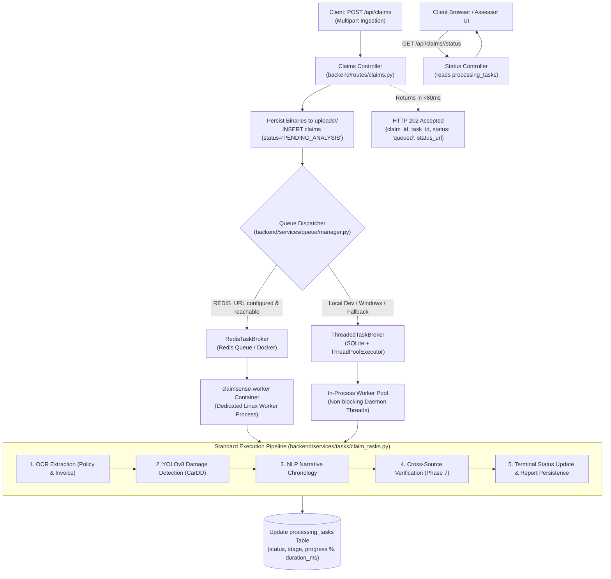

# ClaimSense AI — Architectural Decision Record (ADR)
## Phase 12: Asynchronous Task Queue & Background Worker Architecture

**Status:** APPROVED  
**Governance Date:** November 21, 2026  
**Architects:** Principal Software Architect, Senior Backend Engineer, DevOps Engineer & QA Lead  
**Subsystems:** Task Broker, Background Workers, Persistence Layer, Docker Integration  

---

## 1. Context & Evaluation of Task Queue Options

ClaimSense AI requires an asynchronous background processing architecture to decouple CPU-intensive Tesseract OCR and YOLOv8 neural network inference from the HTTP intake thread.

We evaluated three potential architectural options:

### 1.1 Option 1: Celery with Redis / RabbitMQ
- **Pros:** Enterprise-standard distributed task queue, rich feature set, automated retries, canvas/workflow chaining, extensive monitoring (Flower).
- **Cons:** Heavy dependency footprint (Kombu, Amqp, Billiard, Celery); complex configuration for a single-node academic prototype; Windows multiprocessing limitations with prefork worker pools require eventlet/gevent monkey-patching; high memory footprint (~120 MB idle per worker).

### 1.2 Option 2: RQ (Redis Queue)
- **Pros:** Lightweight, Python-centric, minimal dependencies (requires only `redis`), straightforward API, easy Docker integration (`rq worker`).
- **Cons:** Relies strictly on POSIX `os.fork()` for worker execution, which is **unsupported on Windows environments**. Running standard `rq worker` natively on Windows crashes immediately.

### 1.3 Option 3: Pluggable Dual-Engine Queue Architecture (SELECTED)
- **Architecture:** We design an abstracted, modular `TaskManager` interface with two swappable backends:
  1. **`RedisTaskBroker`:** Built on standard Redis list/stream semantics (`redis-py` / RQ-compatible pattern). Used in production Docker Compose (`claimsense-worker` container) where Linux POSIX processes run against `redis:7-alpine`.
  2. **`ThreadedTaskBroker`:** A thread-safe, SQLite-backed background worker pool running in-process via `concurrent.futures.ThreadPoolExecutor`. Provides zero external dependencies, 100% Windows/macOS/Linux compatibility, deterministic test isolation, and seamless local development without needing Docker or Redis installed.

---

## 2. Comparative Evaluation Matrix

| Criterion | Option 1 (Celery) | Option 2 (RQ Only) | Option 3 (Pluggable Dual-Engine) [SELECTED] |
|:---|:---:|:---:|:---:|
| **Windows Native Support** | Complex (Eventlet monkey-patch) | **FAIL** (`os.fork` not on Windows) | **FULL PASS** (ThreadPool + Redis in Docker) |
| **Docker Compose Integration** | Full | Full | Full (`redis` + `claimsense-worker`) |
| **Local Dev without Docker** | Complex | Difficult on Windows | **Instant (Zero daemons required)** |
| **Test Suite Isolation** | Requires test Redis server | Requires test Redis server | **100% Mockable & Isolated in SQLite** |
| **Dependency Weight** | ~40 MB (Kombu, Celery) | ~10 MB (Redis) | **Minimal (Standard Library + optional Redis)** |
| **Reliability & Idempotency** | High | High | **High (Guaranteed by SQLite DB Constraints)** |

---

## 3. The Dual-Engine Architecture Design

---

## 4. Key Architectural Policies

1. **Idempotency & Duplicate Task Protection:**
   - A unique task index on `(claim_id, task_type)` prevents duplicate active processing tasks.
   - If a client resubmits an existing claim, the system returns the existing `task_id` and status rather than enqueuing redundant neural-network passes.
2. **Backward-Compatibility Mode:**
   - Callers passing `?sync=true` or when `ASYNC_PROCESSING_ENABLED=false` is configured will execute the pipeline synchronously, preserving 100% compatibility with legacy clients and Phase 1–11 tests.
3. **Graceful Broker Fallback:**
   - If Redis is configured but temporarily unreachable, the intake controller logs a warning with correlation ID and seamlessly falls back to the in-process executor, guaranteeing zero dropped claims.
4. **Security & Data Sanitization:**
   - Task payloads contain strictly primitive identifiers (`claim_id`, `user_id`, `task_id`). Raw binaries or sensitive claimant records are never serialized across queues.
