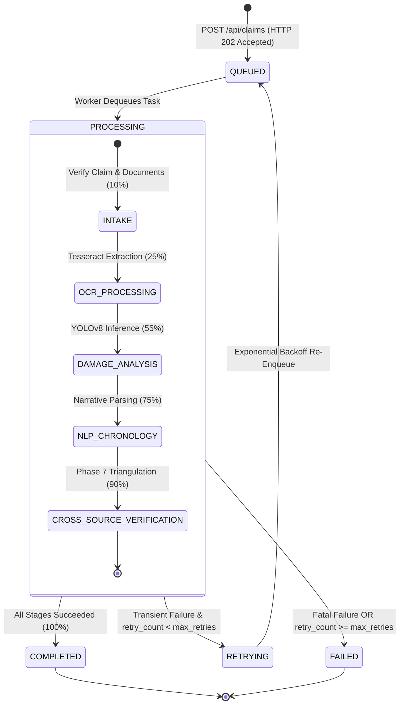

# ClaimSense AI — Task Reliability & Failure Recovery Specification
## Asynchronous Lifecycle, Retry Policies & Idempotency Controls

**Document Reference:** `runs/phase12/reliability/task_reliability_design.md`  
**Governance Date:** November 21, 2026  
**Subsystems:** Task Manager, Background Worker, SQLite Persistence, Error Sanitizer  

---

## 1. Lifecycle State Machine & Valid Transitions

ClaimSense AI enforces deterministic state machine transitions for all background processing tasks:

---

## 2. Idempotency & Duplicate Task Protection

In asynchronous architectures, network latency or double-clicks can cause duplicate HTTP submissions. ClaimSense AI implements three layers of idempotency:

1. **Active Task Indexing:** Before creating a new `ProcessingTask`, `TaskManager` queries SQLite for any existing task with `status IN ('QUEUED', 'PROCESSING')` for the same `claim_id`.
2. **Deterministic Response:** If an active task already exists, the endpoint returns the existing `task_id` and status with HTTP 202, preventing duplicate AI passes.
3. **Database Unique Key:** Relational uniqueness and foreign keys on `(task_id)` guarantee atomic task minting.

---

## 3. Bounded Retries & Error Classification

To prevent poison pill tasks from cycling indefinitely in worker queues, errors are classified:

### 3.1 Non-Retryable (Fatal) Errors:
- `CLAIM_NOT_FOUND`: Target claim reference does not exist in SQLite.
- `EVIDENCE_CORRUPTED`: Uploaded image or PDF violates magic byte validation.
- `UNAUTHORIZED_ACCESS`: User ID does not match claim owner or assessor role.
- **Handling:** Task immediately transitions to `FAILED`. Zero retries attempted.

### 3.2 Retryable (Transient) Errors:
- `SQLITE_BUSY`: Temporary lock contention.
- `TESSERACT_TIMEOUT`: CPU spike during OCR extraction.
- `OUT_OF_MEMORY`: Temporary worker memory pressure.
- **Handling:** Increments `retry_count`. If `retry_count < max_retries` (default 3), waits $2^{\text{retry\_count}} \times 1.0\text{s}$ backoff, updates status to `QUEUED`, and re-dispatches.

---

## 4. Stale Task Detection & Worker Interruption Recovery

If a worker container crashes or restarts while processing a claim:
1. `TaskManager.recover_stale_tasks(timeout_seconds=300)` identifies tasks whose `updated_at` heartbeat is older than 5 minutes.
2. If `retry_count < max_retries`, task status is reset to `QUEUED` and re-submitted to the broker.
3. If max retries have been exhausted, the task is marked `FAILED` with error code `TASK_TIMEOUT`.
4. This routine is triggered automatically on worker startup and exposed via maintenance APIs.
