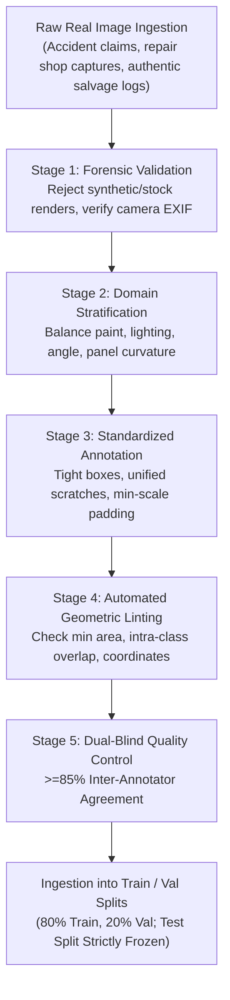

# Phase 8 — Data Expansion & Annotation Quality Plan

**Project:** ClaimSense AI  
**Module:** Phase 8 Computer Vision Dataset Expansion & Annotation Protocol  
**Date:** November 17, 2026  
**Target Architecture:** YOLOv8n (Fine-tuned on CarDD + Curated Expansion)  
**Status:** Strategic Blueprint Ready for Approval  

---

## 1. Executive Summary & Problem Formulation

The Phase 8 Dataset and Evaluation Audits demonstrated that:
1. **Resolution is not the primary bottleneck:** Session 3 proved that scaling whole images to 1024px without addressing dataset limitations increased false positives on reflections (+10 FP on scratches) and collapsed crack recall to 0.00%.
2. **Annotation scarcity and ambiguity limit accuracy:** `crack` has only 91 training instances with a median area of 0.0069; `scratch` suffers from fragmented multi-box labeling; and 47.6% of collision images omit accompanying plastic fractures.
3. **Synthetic data is prohibited:** Consistent with ClaimSense AI project guidelines, only authentic, real-world vehicle damage photographs will be acquired and curated.

This document defines a realistic, phased acquisition, annotation, and quality-control roadmap to expand the training dataset from 210 images to approximately **400–450 curated images**, directly resolving the small-damage detection bottlenecks.

---

## 2. Priority Acquisition Targets & Planning Estimates

*(Note: Target instance counts are planning estimates for dataset balancing, not guaranteed model performance metrics.)*



### 2.1 Class: `crack` (Top Priority — Deficit Remediation)
- **Current Baseline:** 91 train instances (56 images), median area `0.0069`.
- **Target Planned Addition:** **+160 to +200 real instances** (in ~80–100 images).

| Damage Sub-Category | Target Count | Specific Visual Characteristics to Capture |
| :--- | :---: | :--- |
| **Bumper Fascia Splits & Tears** | 70 instances | Plastic bumper covers split from impact; torn mounting tabs; lower air dam cracks. |
| **Fiberglass & Composite Cracks** | 45 instances | Spider-web micro-cracking in fiberglass panels, aftermarket spoilers, and composite hoods. |
| **Sheet-Metal Seam Fractures** | 45 instances | Welded seam splits along fender-to-door jambs, trunk lips, and rocker panels. |
| **Housing & Bezel Fractures** | 30 instances | Headlamp and tail lamp plastic mounting brackets cracked without full lens breakage. |

### 2.2 Class: `scratch` (Precision & Glare Discrimination)
- **Current Baseline:** 258 train instances (154 images), median area `0.0432`.
- **Target Planned Addition:** **+120 to +150 real instances** (in ~60–80 images).

| Damage Sub-Category | Target Count | Specific Visual Characteristics to Capture |
| :--- | :---: | :--- |
| **High-Glare / Specular Scenarios** | 45 instances | Real scratches on panels with bright directional sunlight and overhead workshop lights (to train model to distinguish scratches from glare). |
| **Metallic & Pearlescent Finishes** | 40 instances | Scratches through multi-layer clear coats on metallic gray, silver, and pearl white finishes. |
| **Continuous Key / Panel Scrapes** | 35 instances | Uninterrupted single-box scrapes extending across full doors or rear quarter panels. |
| **Low-Contrast Micro-Scratches** | 25 instances | Clear-coat scuffs and swirl marks on white and champagne paint finishes. |

### 2.3 Class: `dent` (Low-Contrast & Crease Dents)
- **Current Baseline:** 234 train instances (142 images), median area `0.0552`.
- **Target Planned Addition:** **+100 to +130 real instances** (in ~50–70 images).

| Damage Sub-Category | Target Count | Specific Visual Characteristics to Capture |
| :--- | :---: | :--- |
| **Body Crease Line Dents** | 40 instances | Impact depressions crossing sharp body styling lines (door body lines, fender flares). |
| **Shallow & Low-Contrast Dents** | 35 instances | Soft depressions without paint damage on silver/white panels (detected via warped reflections). |
| **Hail Damage Depressions** | 35 instances | Multi-point roof and hood impacts with diameter between 20px and 60px. |
| **Curved Contour Panel Dents** | 20 instances | Dents on compound curved surfaces (wheel arches, roof rails, A-pillars). |

---

## 3. Standardized Annotation Guidelines

To resolve the inconsistencies identified in the Task A audit, annotators must adhere to the following rules:

### Rule 1: Continuous Scratch Unification
- **Standard:** A continuous scrape or scratch trajectory across a single vehicle body panel MUST be labeled as **a single bounding box**.
- **Forbidden:** Partitioning a single continuous line into multiple fragmented boxes (as observed in `000112.jpg` and `000512.jpg`) is strictly prohibited.
- **Multi-Panel Exception:** If a scratch extends continuously across a panel seam (e.g., from front door to rear door), annotators must create **one box per panel**, bounded by the panel shutline.

### Rule 2: Minimum Box Size & Feature Padding (Cracks)
- **Standard:** Every bounding box must have a minimum width and height of **16 pixels** in native image resolution.
- **Hairline Crack Rule:** If a hairline crack is narrower than 16 pixels, annotators must symmetrically expand the box boundary into the adjacent panel texture so the box reaches at least 16x16 pixels.
- **Rationale:** Prevents sub-grid feature collapse in the YOLO P3 detection head.

### Rule 3: Mandatory Collision-Associated Crack Inspection
- **Standard:** Whenever an annotator identifies a `dent` or `lamp broken` on a plastic bumper cover or front/rear clip, they must actively inspect the perimeter for plastic splits, mounting tab tears, and seam fractures.
- **Rule:** If a fracture is visually apparent, it must be annotated as `crack`. It must never be omitted simply because a larger `dent` label is present.

### Rule 4: Hail Damage Cluster Protocol
- **Standard:** Discrete hail dents separated by $\ge 20\text{ px}$ of intact metal must be labeled individually.
- **Cluster Rule:** In catastrophic hail storms where panel deformation forms a continuous textured depression field, annotators must bound the entire cluster as a single region and record `dent` with cluster metadata.

---

## 4. Multi-Stage Quality Control Protocol

```
Stage 1: Automated Pre-Ingestion Linting (scripts/lint_annotations.py)
   ├── Coordinate range check (0.0 <= xc, yc, w, h <= 1.0)
   ├── Minimum area check (flag area < 0.001 for manual inspection)
   └── Intra-class overlap check (flag IoU > 0.40 between same-class boxes)
                │
Stage 2: Dual-Blind Annotation Sampling
   ├── 20% random sample annotated independently by 2 annotators
   ├── Inter-Annotator Agreement (IAA) threshold: >= 85% IoU@50 overlap
   └── Discrepancies arbitrated by Lead Claims Inspector
                │
Stage 3: Negative Sampling & Specular Glare Validation
   └── Ingestion of 25-30 undamaged vehicle images with sharp glare lines
       to verify False Positive rejection
```

### Automated Linting Thresholds

| Lint Check | Threshold | Action on Failure |
| :--- | :---: | :--- |
| **Minimum Box Area** | $< 0.0008$ | Flag for minimum padding or noise rejection |
| **Maximum Aspect Ratio** | $> 25:1$ (extreme needle) | Flag for verification of continuous scratch unification |
| **Same-Class IoU** | $> 0.35$ | Flag for duplicate/overlapping box consolidation |
| **Cross-Class IoU** | $> 0.85$ (`crack` inside `dent`) | Permitted only when crack is a fracture within a dent |

---

## 5. Dataset Ingestion & Partitioning Protocol

1. **Test Split Strict Isolation:**
   - The CarDD test split (`datasets/CarDD_300/test/`, 45 images) is **permanently frozen**.
   - No newly acquired images will ever be added to the test split.
   - The test split will not be used for validation, tuning, or hyperparameter selection.
2. **Train / Validation Allocation:**
   - Newly acquired and verified images will be partitioned strictly into **80% Train** and **20% Validation**.
   - Stratified by damage class to maintain balanced class distributions in validation.
3. **Rollback & Provenance Checksum:**
   - The expanded dataset will be stored under a distinct directory: `datasets/CarDD_Expanded_v1/`.
   - The original `datasets/CarDD_300/` will remain completely preserved and untouched.

---

## 6. Execution Roadmap & Milestones

| Milestone | Target Deliverable | Dependencies |
| :--- | :--- | :--- |
| **Phase 8.1** | Acquire 100 authentic damage images (prioritizing bumper cracks and specular scratches) | Real image sourcing (no synthetic) |
| **Phase 8.2** | Run automated linting and dual-blind review on newly annotated batch | Annotation tooling & lint script |
| **Phase 8.3** | Construct `datasets/CarDD_Expanded_v1` with verified train/val splits | Freeze test split integrity |
| **Phase 8.4** | Execute controlled 640px benchmark training session (15 epochs) | Candidate staging protocol |

---

## 7. Strategic Recommendations & Approval Request

1. **Immediate Next Step:** Authorize the dataset correction and acquisition plan outlined above.
2. **Model Training Decision:** Defer further YOLO training sessions until at least Phase 8.1 (+100 curated real images) is ingested.
3. **Checkpoint Status:** Retain `runs/phase8/session_2/weights/best.pt` (mAP@50 = 41.17%) as the leading staging candidate, while keeping `models/phase5/best.pt` securely in production.
