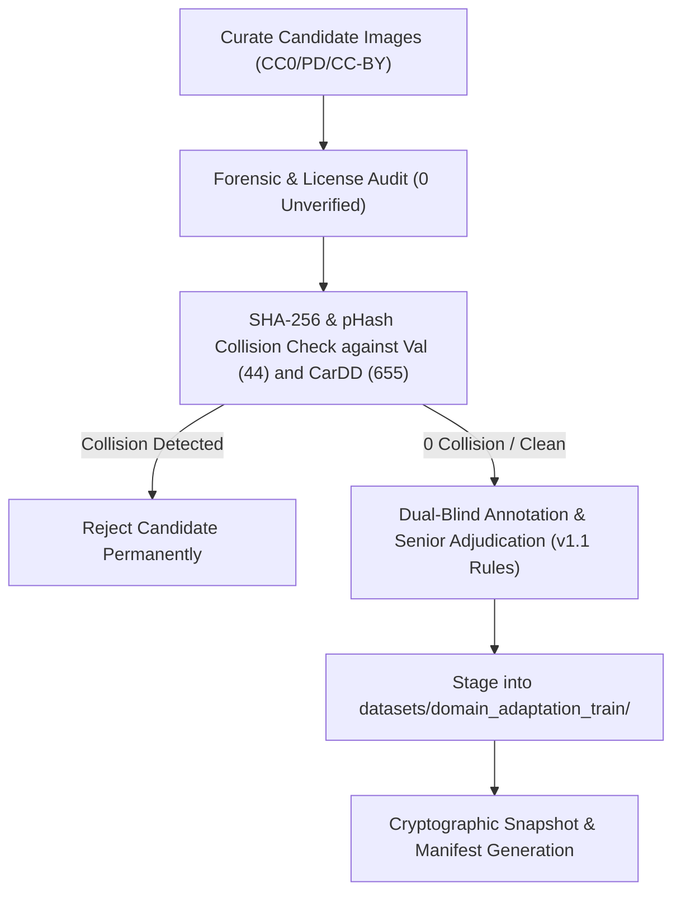

# ClaimSense AI — Phase 8: Gate K Data Requirements Specification

**Document Scope:** Data Sourcing, Specification, and Quality Criteria for Domain Adaptation  
**Governance Gate:** Gate K — Domain Adaptation & Root Cause Analysis  
**Active Specification:** `acquisition_specification.md` — v1.1-ACTIVE  
**Execution Mode:** PLANNING ONLY (No Acquisition Authorized)  
**Status:** COMPLETE

---

## 1. Executive Summary

The Gate I benchmark and Gate K root cause analysis conclusively proved that the model's out-of-domain failure is fundamentally a **data representation deficit**. To enable the three proposed domain adaptation experiments without compromising benchmark integrity, new, authentic vehicle data must be formally specified, sourced, and isolated.

This document defines the exact quantities, categories, licensing, resolution, and annotation criteria required for prospective data intake.

---

## 2. Itemized Intake Requirements by Category

```
Prospective Domain Adaptation Data Intake (120 Images Total)
├── Category A: Clean Background Negative Vehicles (45 Images, 0 Annotations)
├── Category B: Authentic Walkaround Lamp Broken (25 Images, ~30 Instances)
├── Category C: Authentic Walkaround Tire Flat (25 Images, ~28 Instances)
└── Category D: Cosmetic Minor Dings & Hairline Cracks (25 Images, ~30 Instances)
```

### Category A: Clean, Undamaged Vehicles (Negative Mining)
- **Target Quantity:** 45 images.
- **Purpose:** Train the model that sunlight glints, specular paint highlights, door handles, and panel seams on clean cars are background.
- **Specifications:**
  - 100% undamaged passenger vehicles (sedans, SUVs, hatchbacks, trucks).
  - Variety of paint colors: dark glossy (black, navy), high-specular metallic (silver, grey, white), and vibrant (red, blue).
  - Exterior daylight lighting (bright sun, partial overcast, golden hour).
  - Multi-angle walkarounds (front 3/4, side elevation, rear profile).
- **Labeling Protocol:** Empty text files (`*.txt` of 0 bytes).

---

### Category B: Authentic Walkaround Lamp Broken
- **Target Quantity:** 25 images ($\sim 30$ damage instances).
- **Purpose:** Break the $0.0000$ AP deadlock on Class 4.
- **Specifications:**
  - Cracked, broken, chipped, or detached outer lenses on headlights, taillights, fog lights, or turn signals.
  - Vehicles must be structurally intact or have localized bumper impact (NOT demolished front clips).
  - Standard eye-level or waist-level inspection photography.
- **Labeling Protocol (Rule 6 Compliant):**
  - Bounding box must tightly enclose the lighting fixture housing and lens.
  - Class ID = 4 (`lamp broken`).
  - Vehicle glazing (windshields, windows) must NOT be labeled as lamp broken.

---

### Category C: Authentic Walkaround Tire Flat
- **Target Quantity:** 25 images ($\sim 28$ damage instances).
- **Purpose:** Break the $0.0000$ AP deadlock on Class 5.
- **Specifications:**
  - Vehicles parked on asphalt, concrete, or gravel with deflated tires.
  - Clear visible sidewall bulge and rim-to-ground contact or near-contact.
  - Full wheel must be visible in frame from a side or 3/4 walkaround angle.
- **Labeling Protocol:**
  - Bounding box must enclose the entire tire and wheel assembly exhibiting deflation.
  - Class ID = 5 (`tire flat`).

---

### Category D: Cosmetic Minor Dings, Scratches & Cracks
- **Target Quantity:** 25 images ($\sim 30$ damage instances).
- **Purpose:** Train the model on localized, minor insurance claim defects on intact panels.
- **Specifications:**
  - Shallow door dings, hail dents, clearcoat key scratches, bumper stress cracks.
  - High-resolution walkaround framing (damage occupies $2\% - 15\%$ of image area).
- **Labeling Protocol:** Single unified enclosing AABBs under Specification v1.1.

---

## 3. Strict Quality & Legal Provenance Criteria

In strict accordance with the approved Phase 8 Acquisition Plan:

1. **Permitted Legal Licenses:**
   - **CC0 (Public Domain Dedication):** Fully permitted.
   - **Public Domain (US Gov / Wikimedia PD):** Fully permitted.
   - **Creative Commons Attribution (CC BY 2.0 / 3.0 / 4.0):** Permitted with individual attribution metadata sidecar.
   - **PROHIBITED:** CC BY-NC (Non-Commercial), CC BY-ND (No-Derivatives), CC BY-SA (Share-Alike where infectious), copyrighted commercial stock photography (Getty, Shutterstock), unverified web scrape images.
2. **Anti-Synthetic & Forensic Integrity Filter:**
   - All candidate images must pass forensic validation via `validate_vehicle_image()`:
     - No CGI, 3D renderings, or video game graphics (BeamNG, GTA).
     - No synthetic insurance claim graphics, policy schedule PDFs, or diagrams.
     - Natural EXIF camera metadata and natural photographic sensor noise patterns required.
3. **Resolution & Dual-Tier Rules:**
   - **Tier 1 (Walkaround):** Width $\ge 800\text{ px}$ AND Height $\ge 600\text{ px}$.
   - **Tier 2 (Macro):** $\min(\text{width}, \text{height}) \ge 400\text{ px}$ AND $\max(\text{width}, \text{height}) \ge 600\text{ px}$, with verified damage occupancy $\ge 30\%$.
   - **Cumulative Macro Ceiling:** Any future combined dataset must maintain Tier 2 Macro share at $\le 30.00\%$.

---

## 4. Strict Quarantine & Anti-Contamination Protocol

> [!CAUTION]
> **VALIDATION FIREWALL GUARANTEE:**  
> The 44 images and 47 ground-truth instances comprising `CarDD_Independent_Val_v1` (`batch_01` and `batch_02`) represent the independent gold-standard validation benchmark. 
> 
> To guarantee zero data leakage and preserve evaluation integrity:
> 1. New data intake must be isolated in a dedicated directory: `datasets/domain_adaptation_intake/` or `datasets/batch_03/`.
> 2. Cryptographic SHA-256 cross-checks must confirm **0 hash collisions** against all 44 validation images and labels.
> 3. Perceptual hashing (pHash) must confirm **0 near-duplicate matches** against the validation set.

---

## 5. Intake Ingestion Workflow



**Status:** Staged and ready for execution upon separate formal governance authorization.
