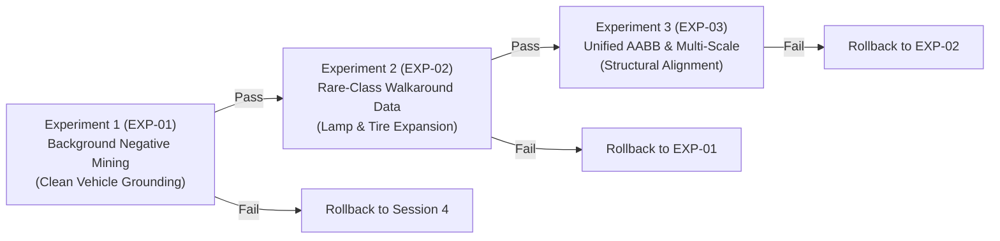

# ClaimSense AI — Phase 8: Gate K Experiment Proposals

**Document Scope:** Controlled Engineering Proposals for Domain Adaptation  
**Governance Gate:** Gate K — Domain Adaptation & Root Cause Analysis  
**Active Specification:** `acquisition_specification.md` — v1.1-ACTIVE  
**Execution Mode:** STRICTLY PLANNING ONLY (No Execution Authorized)  
**Target Hardware:** NVIDIA GeForce RTX 3050 Laptop GPU (4GB VRAM)  
**Status:** COMPLETE

---

## 1. Overview of Proposed Experiment Pipeline

To methodically resolve the domain gap diagnosed in Gate I and Gate J, three sequential, hypothesis-driven experiments are proposed. Each experiment isolates specific variables, enforces rigorous success/failure gates, and includes a zero-risk rollback mechanism.

---

## 2. Experiment 1 (EXP-01): Background Negative Mining & Specular Reflection Suppression

### 2.1 Scientific Hypothesis
Adding $15\%$ clean, undamaged vehicle photographs (with empty label files) to the training pipeline will penalize False Positive proposals on automotive paint during backpropagation, reducing daylight specular reflection false alarms by $\ge 50\%$ without degrading defect recall.

### 2.2 Dataset Requirements
- **Base Dataset:** Existing `CarDD_Expanded_v1` (310 collision images).
- **Negative Supplement:** 45 authentic, clean, undamaged vehicle walkaround photographs (CC0 / Public Domain / Wikimedia Commons, completely separate from the 44-image validation set).
- **Labels:** 45 empty text files (0 bytes) representing 0 ground-truth objects.
- **Validation Firewall:** Frozen 44-image validation set strictly excluded.

### 2.3 Model Initialization Checkpoint
- **Checkpoint:** Phase 8 Session 4 (`runs/phase8/session_4_training_01/weights/best.pt`)
- **SHA-256 Digest:** `ea53eee94e508bbb81620b47b2a23c9826341b6b5a6981d9371e476cb9d0594f`

### 2.4 Training Configuration
| Parameter | Value | Rationale |
| :--- | :--- | :--- |
| **Model Architecture** | YOLOv8n (Detection) | Unchanged production base |
| **Input Resolution (`imgsz`)** | 640 × 640 | Standardized optimal resolution |
| **Batch Size (`batch`)** | 4 | Safe for 4GB VRAM envelope |
| **Epochs** | 15 | Sufficient for background feature alignment |
| **Optimizer** | AdamW | Robust against catastrophic forgetting |
| **Learning Rate (`lr0`, `lrf`)** | `lr0 = 0.0005`, `lrf = 0.01` | Gentle fine-tuning rate |
| **LR Schedule** | Cosine Annealing (`cos_lr = True`) | Smooth gradient decay |
| **Mosaic Augmentation** | 0.50 (disabled in last 3 epochs) | Panel context stabilization |
| **Random Erasing** | 0.0 | Prevent deleting subtle damage |

### 2.5 Controlled Variables
- **Independent Variable:** Addition of 45 clean vehicle negative training images.
- **Fixed Variables:** Network weights, base CarDD images, resolution (640px), optimizer, loss functions.

### 2.6 Quantitative Success & Failure Criteria
- **Success Criteria:**
  1. Background false-positive proposals on the independent validation set drop from 2,185 to $\le 1,100$ (a $\ge 50\%$ reduction).
  2. Macro precision increases from $0.1894$ to $\ge 0.3000$.
  3. Recall on Glass Shatter and Dent does not decrease by more than $0.5\%$.
- **Failure Criteria:**
  1. Total recall collapses to $< 1.5\%$.
  2. Background false-positive proposals decrease by $< 20\%$.

### 2.7 Hardware & Compute Feasibility
- **Peak VRAM Allocated:** $\sim 850\text{ MiB}$ (well within 4,096 MiB budget).
- **Estimated Training Duration:** $\sim 3.5\text{ minutes}$ on RTX 3050 Laptop GPU.
- **Thermal Budget:** Expected peak temperature $\le 70\text{ ^\circ C}$.

### 2.8 Risks & Rollback Strategy
- **Risk:** Network over-suppresses all predictions, causing further recall loss.
- **Rollback:** Discard EXP-01 weights; retain Session 4 as the candidate checkpoint.

---

## 3. Experiment 2 (EXP-02): Targeted Rare-Class Walkaround Expansion & Class-Weighted Loss

### 3.1 Scientific Hypothesis
Introducing 50 authentic walkaround images of cracked lamp housings and deflated tires, combined with class-weighted loss ($2.5\times$ weight on Lamp Broken and $3.0\times$ weight on Tire Flat), will provide the necessary feature gradients to break the $0.0000$ AP deadlock on these two classes.

### 3.2 Dataset Requirements
- **Base Dataset:** EXP-01 training set (CarDD Expanded + clean negatives).
- **Targeted Rare-Class Intake:**
  - 25 authentic walkaround images depicting cracked/broken vehicle lamp lenses (Rule 6 compliant).
  - 25 authentic walkaround images depicting deflated/flat tires on parked vehicles.
  - Sourced exclusively from verified CC0/PD repositories (zero overlap with validation set).
- **Total Training Instances Added:** $\sim 30$ Lamp Broken instances, $\sim 28$ Tire Flat instances.

### 3.3 Model Initialization Checkpoint
- **Checkpoint:** Best weights from EXP-01 (or Session 4 if EXP-01 rolled back).

### 3.4 Training Configuration
| Parameter | Value | Rationale |
| :--- | :--- | :--- |
| **Input Resolution (`imgsz`)** | 640 × 640 | Preserved standard resolution |
| **Batch Size (`batch`)** | 4 | Preserved standard batch size |
| **Epochs** | 20 | Ample iterations for rare-class convergence |
| **Optimizer** | AdamW (`lr0 = 0.0004`, `lrf = 0.01`) | Fine-tuning convergence |
| **Class Loss Weights** | Dent: 1.0, Scratch: 1.0, Crack: 1.5, Glass: 1.5, **Lamp: 2.5, Tire: 3.0** | Compensate for instance frequency deficit |
| **HSV Jitter** | `hsv_h = 0.015, hsv_s = 0.7, hsv_v = 0.4` | Color variance for lamp and tire textures |

### 3.5 Controlled Variables
- **Independent Variable:** Addition of 50 rare-class walkaround images + class loss weighting.
- **Fixed Variables:** Network architecture, clean background negatives, image resolution.

### 3.6 Quantitative Success & Failure Criteria
- **Success Criteria:**
  1. **Lamp Broken AP@50** on independent validation improves from $0.0000$ to **$\ge 0.0300$** (at least 1 true positive at IoU $\ge 0.50$).
  2. **Tire Flat AP@50** on independent validation improves from $0.0000$ to **$\ge 0.0400$** (at least 2 true positives at IoU $\ge 0.50$).
  3. Empirical pooled mAP@50 increases to $\ge 0.0200$ (a $3.3\times$ increase over Session 4).
- **Failure Criteria:**
  1. Lamp Broken and Tire Flat AP@50 both remain at $0.0000$.
  2. Overall validation mAP@50 decreases.

### 3.7 Hardware & Compute Feasibility
- **Peak VRAM Allocated:** $\sim 920\text{ MiB}$ ($22.5\%$ of 4GB VRAM).
- **Estimated Training Duration:** $\sim 5.0\text{ minutes}$ on RTX 3050 Laptop GPU.

### 3.8 Risks & Rollback Strategy
- **Risk:** High class weights on Tire and Lamp cause false positive explosions on round wheel rims or headlights.
- **Rollback:** Discard EXP-02 weights; revert to EXP-01.

---

## 4. Experiment 3 (EXP-03): Unified AABB Annotation Adaptation & Multi-Scale Feature Alignment

### 4.1 Scientific Hypothesis
Re-annotating fragmented multi-box CarDD training clusters into unified single-enclosing AABBs matching Specification v1.1, combined with mild multi-scale training ($[512, 640, 768]$), will eliminate bounding-box IoU mismatch and improve overall empirical pooled mAP@50 beyond $0.0500$ ($5\%$).

### 4.2 Dataset Requirements
- **Base Dataset:** Complete EXP-02 dataset (CarDD Expanded + clean negatives + rare walkaround classes).
- **Annotation Refactoring:** Algorithmic and human-verified cluster merging on CarDD training labels: contiguous overlapping boxes on identical panels merged into single enclosing AABBs.

### 4.3 Model Initialization Checkpoint
- **Checkpoint:** Best weights from EXP-02.

### 4.4 Training Configuration
| Parameter | Value | Rationale |
| :--- | :--- | :--- |
| **Input Resolution (`imgsz`)** | 640 (dynamic multi-scale $\pm 20\%$) | Multi-scale scale invariance ($512 - 768\text{ px}$) |
| **Multi-Scale Flag** | `multi_scale = True` | Randomly sample image size every 10 batches |
| **Batch Size (`batch`)** | 4 (fallback: 2 if VRAM spikes at 768px) | Dynamic safety envelope |
| **Epochs** | 25 | Deep structural convergence |
| **Close Mosaic** | 5 | Unfragmented natural scene settling |
| **Optimizer** | AdamW (`lr0 = 0.0003`, `lrf = 0.01`) | Fine-tuning convergence |

### 4.5 Controlled Variables
- **Independent Variable:** Unified enclosing bounding-box labels + multi-scale dynamic resolution.
- **Fixed Variables:** Class loss weights, background negative ratio, dataset image inventory.

### 4.6 Quantitative Success & Failure Criteria
- **Success Criteria:**
  1. **Empirical Pooled mAP@50** on independent validation reaches **$\ge 0.0500$ ($5.0\%$)** (an $8.3\times$ improvement over Session 4).
  2. **Fixed-Weight Composite mAP@50** reaches **$\ge 0.0500$**.
  3. Non-zero AP achieved across at least 5 of the 6 damage categories.
  4. Total empirical recall on independent validation reaches $\ge 15.0\%$.
- **Failure Criteria:**
  1. Pooled mAP@50 fails to reach $0.0200$.
  2. Multi-scale scaling exceeds 3.5 GB VRAM or causes CUDA OOM.

### 4.7 Hardware & Compute Feasibility
- **Peak VRAM Allocated:** $\sim 1.8\text{ GB}$ at 768px batch size 4 (well within 4.0 GB budget).
- **Estimated Training Duration:** $\sim 8.5\text{ minutes}$ on RTX 3050 Laptop GPU.

### 4.8 Risks & Rollback Strategy
- **Risk:** Multi-scale feature jitter degrades localized edge detection on fine cracks.
- **Rollback:** Discard EXP-03 weights; revert to EXP-02.

---

## 5. Experiment Prioritization & Resource Summary

| Exp ID | Focus Area | Dataset Change | Starting Model | Primary Success Metric | Est. VRAM | Est. Time | Priority |
| :---: | :--- | :--- | :---: | :--- | :---: | :---: | :---: |
| **EXP-01** | False-Positive Suppression | +45 Clean Negative Vehicles | Session 4 | $\ge 50\%$ Background FP Reduction | 850 MB | 3.5 min | **1 (Immediate)** |
| **EXP-02** | Rare-Class Blind Spots | +50 Lamp/Tire Walkarounds | EXP-01 | Non-zero AP on Lamp & Tire ($> 0.03$) | 920 MB | 5.0 min | **2 (Sequential)** |
| **EXP-03** | Structural AABB Alignment | Unified AABB Labels + Multi-Scale | EXP-02 | Pooled mAP@50 $\ge 0.0500$ (5%) | 1.8 GB | 8.5 min | **3 (Sequential)** |

**Execution Notice:** In strict accordance with Gate K restrictions, **no experiment is authorized for execution**. All configurations are staged pending explicit governance approval.
