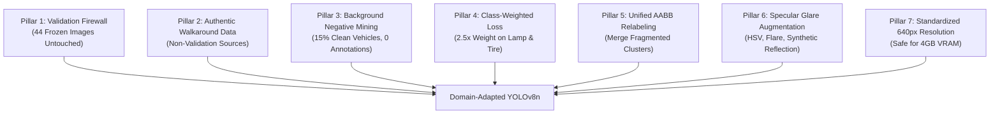

# ClaimSense AI — Phase 8: Gate K Training Strategy Design

**Document Scope:** Methodological Framework for Domain Adaptation & Real-World Generalization  
**Governance Gate:** Gate K — Domain Adaptation & Root Cause Analysis  
**Active Specification:** `acquisition_specification.md` — v1.1-ACTIVE  
**Target Hardware:** NVIDIA GeForce RTX 3050 Laptop GPU (4GB VRAM)  
**Status:** COMPLETE (Planning & Methodology Framework Only)

---

## 1. Strategic Philosophy & Core Objective

The empirical findings of Gate I, Gate J, and Gate K prove that further training solely on CarDD cannot bridge the domain gap to real-world insurance claim walkaround photography. 

The objective of the **Gate K Domain Adaptation Strategy** is to transform the existing YOLOv8n detector from a *collision-reconstruction model* into an *authentic vehicle inspection model*. This requires balancing two competing objectives:
1. **Suppressing Spurious Background Activations:** Eliminating the thousands of false alarms triggered by daylight reflections, styling lines, and panel seams on undamaged bodywork.
2. **Restoring Defect Sensitivity (Recall):** Teaching the network to detect subtle, cosmetic defects (door dings, hairline cracks, stone chips, flat tire sidewall deflections, cracked lamp lenses) at operational confidence thresholds ($conf \ge 0.25$).

---

## 2. Seven Pillar Methodological Framework



### Pillar 1: Strict Validation Data Firewall
- The 44 frozen images and 47 ground-truth instances comprising `CarDD_Independent_Val_v1` **must remain 100% untouched and isolated**.
- Under zero circumstances may any validation image or crop be included in training sets, background negative mining, data augmentation, hyperparameter sweeps, or checkpoint selection.
- All training data expansion must originate from separate, independently verified batches (e.g. prospective Batch 3 or non-validation CC0/PD repositories).

---

### Pillar 2: Authentic Real-World Domain Data Integration
- Introduce real-world vehicle walkaround photographs into the training pipeline.
- Implement a **50/50 Domain-Balanced Training Mixture**:
  - $50\%$ CarDD images (retaining structural damage knowledge).
  - $50\%$ authentic walkaround images (daylight, multi-angle, standard insurance claim perspectives).
- Ensures convolutional filters encounter sharp, high-resolution automotive paint and modern vehicle styling during gradient updates.

---

### Pillar 3: Clean Vehicle Hard-Negative Mining
- Currently, $100\%$ of CarDD training images contain damage. The network has never observed an undamaged vehicle panel; it implicitly assumes that every vehicle image contains defect bounding boxes.
- **Protocol:** Introduce **$15\%$ clean, undamaged vehicle photographs** into the training set with empty label files (`*.txt` files of 0 bytes).
- **Mechanism:** When the detector predicts bounding boxes on clean panels, backpropagation applies pure False Positive penalties across classification and bounding box regression branches, forcing the network to learn that polished paint, door handles, wheel rims, and chrome trim are background.

---

### Pillar 4: Class-Frequency Loss Rebalancing
- To overcome the severe class imbalance (where `tire flat` has only 22 training examples vs 269 dents), modify the YOLOv8 classification loss using class-frequency weighting:
  $$\mathcal{L}_{\text{cls}} = -\sum_{c=0}^5 w_c \cdot \left[ y_c \log(\hat{y}_c) + (1 - y_c) \log(1 - \hat{y}_c) \right]$$
  where:
  $$w_{\text{dent}} = 1.0, \quad w_{\text{scratch}} = 1.0, \quad w_{\text{crack}} = 1.5, \quad w_{\text{glass}} = 1.5, \quad w_{\text{lamp}} = 2.5, \quad w_{\text{tire}} = 3.0$$
- This prevents gradient starvation on `lamp broken` and `tire flat`, forcing the network to prioritize feature convergence on rare classes.

---

### Pillar 5: Unified AABB Annotation Alignment
- Eliminate the annotation structural mismatch between fragmented CarDD multi-boxing and Specification v1.1 evaluation standards.
- In prospective training tranches and curated CarDD subsets, apply automated and human-reviewed box clustering: merge contiguous overlapping bounding boxes on the same panel into a single enclosing AABB.
- Aligns training targets directly with the IoU $\ge 0.50$ evaluation matching protocol.

---

### Pillar 6: Specular Glare & Ambient Reflection Augmentation
- Implement targeted data augmentation simulating daylight clearcoat behavior:
  - **Color Jitter (HSV):** Expand hue ($hsv\_h = 0.02$), saturation ($hsv\_s = 0.8$), and brightness ($hsv\_v = 0.5$) to simulate variable sun angles.
  - **Random Specular Glare:** Apply synthetic gradient overlays and brightness streaks simulating sun reflections across hoods and windshields.
  - **Mosaic & CutMix:** Maintain Mosaic at $0.50$, closing mosaic during the final 5 epochs (`close_mosaic = 5`) to allow natural unfragmented feature stabilization.

---

### Pillar 7: Resolution & Hardware Envelope Preservation
- As proven in Session 3, whole-image upscaling to 1024px increases false alarms and harms recall on micro-cracks.
- Maintain base input resolution at **`imgsz = 640`**.
- This guarantees optimal anchor/stride alignment, prevents spatial overfitting, and keeps peak VRAM safely under **$1.5\text{ GB}$** on the local NVIDIA GeForce RTX 3050 Laptop GPU (leaving over $60\%$ VRAM headroom).

---

## 3. Two-Stage Fine-Tuning Architecture

```
Stage 1: False-Positive Suppression & Background Grounding
├── Starting Weights: Phase 8 Session 4 (best.pt)
├── Training Data: CarDD Expanded + 15% Clean Negative Vehicles
├── Hyperparameters: lr0=0.0005, AdamW, cosine LR, 15 epochs, imgsz=640, batch=4
└── Target: Reduce background false-positive proposals by >= 50%
           │
           ▼
Stage 2: Rare-Class Transfer & Boundary Alignment
├── Starting Weights: Best Stage 1 Checkpoint
├── Training Data: Balanced CarDD + 50+ Authentic Lamp/Tire Images + Class Weights
├── Hyperparameters: lr0=0.0003, AdamW, class weights (2.5x lamp, 3.0x tire), 20 epochs
└── Target: Achieve non-zero AP (> 0.05) on Lamp Broken and Tire Flat; Pooled mAP50 > 0.03
```

---

## 4. Governance Compliance & Boundary Safeguards

1. **No Data Contamination:** The 44-image validation dataset is strictly quarantined.
2. **Reproducibility:** All future training runs must log full random seeds (`seed = 42`), hardware thermals, training curves, and pre/post SHA-256 hashes.
3. **Rollback Immutability:** If an experiment fails to satisfy defined success criteria, the experiment checkpoint is permanently isolated, and production pointers remain on `models/phase5/best.pt`.
