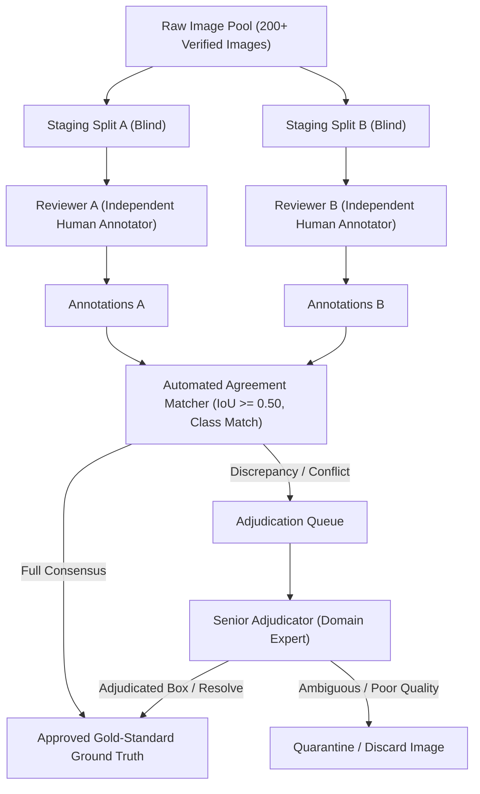

# ClaimSense AI — Dual-Blind Annotation & Adjudication Protocol

**Dataset:** `CarDD_Independent_Val_v1` (200+ Images)  
**Goal:** Establish gold-standard, human-audited ground-truth annotations with mathematical inter-annotator agreement and zero leakage from model predictions.

---

## 1. Dual-Blind Annotation Workflow

To eliminate cognitive bias and prevent subjective annotation creep, ground truth is created through an isolated dual-blind pipeline:

### Reviewer Roles & Isolation:
1. **Reviewer A & Reviewer B:** Independent annotators. Neither reviewer has access to the other reviewer's labels, model predictions, or historical CarDD annotations.
2. **Senior Adjudicator (Adjudicator C):** Senior automotive insurance appraiser or lead computer vision scientist. Reviews only cases where Reviewer A and Reviewer B disagree.
3. **No Model-Assisted Labeling:** Zero pre-labels from YOLO, Segment Anything (SAM), or pre-trained models. All initial boxes must be drawn manually.

---

## 2. Class-Specific Bounding Box Delineation Rules

### A. Dent (Class 0)
- **Boundary:** Box must tightly encompass the full perimeter of plastic or sheet metal deformation, including the outer transition inflection zone.
- **Crease vs Soft Dent:** Deep crease lines embedded inside larger soft dents must be labeled as a **single unified dent**, NOT segmented into multiple micro-boxes.
- **Exclusion:** Do NOT annotate manufactured body lines, factory aerodynamic grooves, or door handle recesses.

### B. Scratch (Class 1)
- **Continuous vs Segmented:** Continuous scrape marks spanning a single body panel must be encompassed in a single bounding box.
- **Panel Transitions:** When a long key scratch crosses a door gap from fender to door, draw **separate boxes on each panel** to conform to panel repair cost modeling.
- **Cluster Scratches:** A patch of parallel swirl marks or gravel abrasion within a localized $10 \times 10\text{ cm}$ area should be bounded as a single scratch box.
- **Exclusion:** Surface dirt streaks, dried water drip lines, and dust trails must NOT be annotated.

### C. Crack (Class 2)
- **Hairline vs Structural Split:** Must capture both fine hairline fractures (common on bumper fascias) and open structural splits.
- **Boundary Tightness:** Box must tightly enclose the crack from its initiation tip to its termination tip, plus immediate cracked surrounding plastic ($< 5\text{ mm}$ margin).
- **Exclusion:** Do NOT annotate normal panel shut-lines, bumper-to-fender seams, or rubber weatherstripping.

### D. Glass Shatter (Class 3)
- **Windshield Chips vs Shattered Tempered Glass:**
  - Star chips, bullseye pits, and radial cracks on laminated windshields: Box around the crack halo.
  - Tempered side/rear glass shattered into granular fragments: Box the entire shattered pane area.
- **Exclusion:** Surface insect splatter, bird droppings, or wiper smudge lines.

### E. Lamp Broken (Class 4)
- **Scope:** Box must tightly enclose the damaged assembly (outer clear lens crack, missing housing fragment, or crushed reflector bowl).
- **Minor vs Total:** If the entire lamp assembly is obliterated, box the full lamp cavity. If only a corner crack exists, box only the fractured lens region.
- **Exclusion:** Intact headlamp lenses with internal condensation (unless accompanied by a visible physical fracture).

### F. Tire Flat (Class 5)
- **Boundary:** Box must bound the deflated tire profile, specifically capturing the sidewall contact bulge where the rim pinches the ground.
- **Tread Separation:** If the tire has suffered a blowout, box the delaminated tread strip.
- **Exclusion:** Normal tire tread contact patches on correctly inflated tires; shadows beneath the tire.

---

## 3. Consensus & Agreement Formulation

For every image, predictions from Reviewer A ($\mathcal{A}$) and Reviewer B ($\mathcal{B}$) are mathematically paired:

### Mathematical Consensus Criteria:
A label box $b_A \in \mathcal{A}$ and $b_B \in \mathcal{B}$ are defined as **Consensus** if and only if:
1. $\text{class}(b_A) == \text{class}(b_B)$
2. $\text{IoU}(b_A, b_B) \ge 0.50$

When Consensus is met, the gold-standard box is calculated as the mean coordinate box:
$$b_{\text{gold}} = \frac{1}{2}(b_A + b_B)$$

### Dispute Triggers (Flagged for Adjudication):
1. **Class Disagreement:** $\text{IoU}(b_A, b_B) \ge 0.50$ but $\text{class}(b_A) \neq \text{class}(b_B)$ (e.g. scratch vs crack dispute).
2. **Boundary Disagreement:** $\text{class}(b_A) == \text{class}(b_B)$ but $\text{IoU}(b_A, b_B) < 0.50$ (e.g. consolidation disagreement).
3. **Missing Instance (False Positive / False Negative Disagreement):** Box drawn by Reviewer A has zero overlapping box drawn by Reviewer B ($\text{IoU} < 0.10$).

---

## 4. Quantitative Quality Metrics for Annotation Sign-Off

Before the dataset is unlocked for model benchmarking, the dataset must meet strict statistical reliability criteria:
- **Mean Inter-Annotator Agreement (mIoU):** Must exceed **$0.70$** across consensus boxes.
- **Categorical Cohen's Kappa ($\kappa$):** Must exceed **$0.80$** (substantial to near-perfect agreement).
- **Adjudication Ratio:** The percentage of instances requiring Senior Adjudicator resolution must be documented; if $> 25\%$ of instances are disputed, an annotation guideline refinement workshop is triggered.
