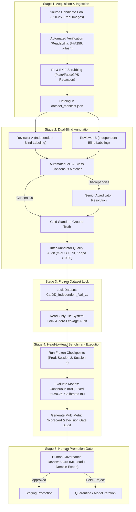

# ClaimSense AI — Phase 8 Independent Real-World Validation Master Plan

**Document Identifier:** `PLAN-PHASE8-VAL-001`  
**Status:** APPROVED FOR STAGING (Planning / Audit Only)  
**Execution Restriction:** Strictly planning only. No training, no data ingestion, no threshold deployment, and no production promotion.  
**Destination Directory:** `runs/phase8/independent_validation_plan/`

---

## 1. Plan Architecture & Document Index

This master plan establishes the end-to-end framework for acquiring, vetting, annotating, governing, and evaluating an independent real-world dataset of 200+ authentic vehicle-damage images:

| Document | File Path | Scope & Purpose |
| :--- | :--- | :--- |
| **Acquisition Specification** | [acquisition_specification.md](file:///c:/Users/ansh9/Desktop/Claimsense%20Ai/runs/phase8/independent_validation_plan/acquisition_specification.md) | Minimum 200 authentic images from insurance claims and fleet walkarounds, class quotas (Dent 70+, Scratch 75+, Crack 50+, Glass 35+, Lamp 40+, Tire 25+), camera angle/lighting variety, panel distribution, and resolution standards. |
| **Annotation Protocol** | [annotation_protocol.md](file:///c:/Users/ansh9/Desktop/Claimsense%20Ai/runs/phase8/independent_validation_plan/annotation_protocol.md) | Dual-blind independent annotation workflow (Reviewer A vs Reviewer B), mathematical consensus ($\text{IoU} \ge 0.50$), Senior Adjudicator resolution, class-specific boundary guidelines, and inter-annotator agreement metrics ($\kappa \ge 0.80$). |
| **Data Governance Checklist** | [data_governance_checklist.md](file:///c:/Users/ansh9/Desktop/Claimsense%20Ai/runs/phase8/independent_validation_plan/data_governance_checklist.md) | Provenance tracking schema, license clearance, automated & manual PII scrubbing (license plates, faces, VINs, EXIF GPS), zero-leakage anti-duplication audits, and strict train/val/test segregation. |
| **Model Evaluation Protocol** | [evaluation_protocol.md](file:///c:/Users/ansh9/Desktop/Claimsense%20Ai/runs/phase8/independent_validation_plan/evaluation_protocol.md) | Standardized head-to-head testing of frozen checkpoints (Production, Session 2, Session 4) across Continuous mAP, Fixed Cutoff ($\tau=0.25$), and Blind Calibrated Thresholds, with multi-metric human sign-off gates. |
| **Risk Register** | [risk_register.md](file:///c:/Users/ansh9/Desktop/Claimsense%20Ai/runs/phase8/independent_validation_plan/risk_register.md) | In-depth failure mode analysis covering Session 4 scratch confidence attenuation, panel seam confusions, specular sun glints, hairline crack resolution limits, small-sample overfitting, and mitigation triggers. |

---

## 2. Chronological Staging & Execution Roadmap

---

## 3. Strict Execution Constraints & Non-Actions

In full compliance with instructions:
- **Zero Training:** No model has been retrained, fine-tuned, or updated.
- **Zero Data Ingestion:** No images have been scraped, downloaded, or synthesized.
- **Zero Threshold Deployment:** Advisory thresholds remain study findings only; no thresholds have been integrated or altered in the application or verification engine.
- **Zero Production Mutation:** Production model `models/phase5/best.pt` remains active, frozen, and completely untouched.
- **Zero Benchmark Modification:** All historical benchmark runs, reports, and checkpoints remain intact.
