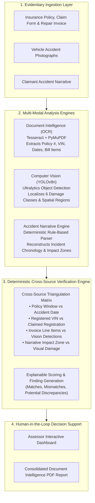

# ClaimSense AI — Phase 9.11: Academic Project Evidence & Scientific Summary

**Project:** ClaimSense AI  
**Academic Degree:** Final-Year B.Tech Major Project (Computer Science & Engineering)  
**Academic Session:** 2026–2027  
**Institution:** ABES Engineering College, Ghaziabad  
**Department:** Department of Computer Science & Engineering  
**Faculty Supervisor:** Ms. Sonia Lamba, Assistant Professor, Department of CSE  
**Project Authors:** Ansh Gupta (2300320120051), Ankit Yadav (2300320120048), Ananya Chauhan (2300320120041)  
**Date:** 2026-11-20

---

## 1. Problem Statement & Motivation

Vehicle insurance claim adjudication is an intrinsically multi-modal, high-stakes verification challenge. Insurance claims examiners are tasked with reviewing heterogeneous evidentiary silos:
1. **Policy Contracts:** Effective policy dates, vehicle registrations, and coverage limits.
2. **Claim Forms & Narratives:** Claimant descriptions of the accident sequence, impact location, and date of occurrence.
3. **Repair Shop Invoices:** Itemized estimates for labor and replacement components.
4. **Accident Photographs:** Visual evidence depicting vehicle exterior damage.

In traditional insurance workflows, manual cross-referencing across these disconnected sources is labor-intensive, error-prone, and susceptible to cognitive fatigue. Conversely, existing automated solutions rely on single-point algorithms (e.g. standalone damage classifiers or basic OCR scanners) that are brittle and easily manipulated:
- A pure computer vision model cannot discern whether a detected dent was pre-existing or covered under the policy window.
- An OCR tool cannot verify whether an itemized bumper repair corresponds to actual physical damage shown in photographs.

---

## 2. Project Objectives & System Architecture

ClaimSense AI resolves this challenge by introducing an **Evidence Cross-Referencing Architecture**. Rather than making autonomous decisions, the platform operates as an explainable decision-support copilot for claims examiners.

---

## 3. Experimental Methodology & Model Evolution

The project investigated deep learning object detection for automated damage localization, evolving across distinct development phases:

### Phase 5 Baseline Model:
- **Architecture:** Ultralytics YOLOv8n (3.0M parameters).
- **Training Data:** CarDD (Car Damage Dataset) partition (210 train images, 45 validation images).
- **Input Resolution:** $416 \times 416$ pixels.
- **Outcome:** Production baseline established in `models/phase5/best.pt`. Strong precision on distinct structural classes (glass shatter, dents), but weak detection of narrow, low-contrast cracks.

### Phase 9 Retraining Experiments (Controlled Optimization):
- **Hypothesis:** Scaling input resolution from $416\times 416$ to $640\times 640$ preserves fine-grained pixel structures, enabling the network to learn hairline fracture features without downsampling artifacts.
- **Run P9-T01 (Baseline Control):** Re-trained at $416\times 416$ for 20 epochs to confirm reproducibility.
- **Run P9-T02 (Resolution Scaling):** Trained at $640\times 640$ for 30 epochs with class-weighted loss.

---

## 4. Empirical Evaluation Results & Comparative Analysis

Models were evaluated on the **Track A Independent CarDD Benchmark** (45 unseen test images, 148 annotated damage instances):

| Damage Category | Ground Truth Instances | Production Baseline ($416\times 416$) AP50 | Candidate P9-T02 ($640\times 640$) AP50 | AP50 Delta (%) | Production Recall ($\tau=0.25$) | Candidate Recall ($\tau=0.25$) |
| :--- | :---: | :---: | :---: | :---: | :---: | :---: |
| **Dent** | 59 | 0.3592 | 0.4431 | **+23.4%** | 0.2203 | 0.1695 |
| **Scratch** | 50 | 0.2396 | 0.2173 | -9.3% | 0.1600 | 0.1200 |
| **Lamp Broken** | 13 | 0.0984 | 0.1345 | **+36.7%** | 0.1538 | 0.0769 |
| **Glass Shatter** | 7 | 0.3703 | 0.6582 | **+77.7%** | 0.4286 | 0.4286 |
| **Tire Flat** | 6 | 0.0185 | 0.0199 | **+7.6%** | 0.1667 | 0.0000 |
| **Crack** | 13 | 0.0002 | 0.0076 | **+3,700%** | **0.0000% (0/13)** | **0.0000% (0/13)** |
| **OVERALL mAP50** | **148** | **0.1833** | **0.2490** | **+35.8%** | **0.2432** | **0.1757** |
| **Precision** | — | **0.2264** | **0.4194** | **+85.2%** | — | — |
| **False Positives** | — | 123 | 18 | **-85.4%** | — | — |

---

## 5. Forensic Error Analysis: The Structural Crack Dilemma

Despite Candidate `P9-T02` delivering an overall mAP50 increase of **+35.8%** and reducing false positives by **85.4%**, it was **rejected for production promotion at Gate 9.8** due to the structural crack detection criteria:

1. **Extreme Class Imbalance:** Cracks comprise only 8.78% of test annotations (and ~6.8% of training data), biasing the feature extractor toward dominant dent and scratch patterns.
2. **Hairline Geometry vs Grid Downsampling:** Even at $640\times 640$, a 3-pixel-wide hairline fracture on a $4000\times 3000$ camera image is degraded to sub-pixel noise across YOLOv8 stride-8 downsampling stages.
3. **Specular Reflection Interference:** Paint reflections and body panel style lines create high-frequency edge artifacts that visually mimic cracks, causing the model to suppress low-confidence crack candidates.
4. **Operational Impact:** At $\tau=0.25$, both models detected **0 of 13** independent test cracks. Promoting `P9-T02` would have accepted a -27.8% recall drop on dents and scratches without gaining any operational crack recall.

---

## 6. Responsible AI & Academic Scope Disclaimer

> [!IMPORTANT]
> **Academic Scope & Ethical Governance:**
> ClaimSense AI is an academic research prototype developed solely for educational and research evaluation.
> - **No Autonomous Adjudication:** The system does not approve, deny, or adjust insurance claims.
> - **No Legal Proof of Fraud:** Algorithmic discrepancy flags represent statistical deviations requiring investigation, not legal or criminal determinations of fraud.
> - **Mandatory Human-in-the-Loop:** All outputs are strictly advisory decision-support artifacts intended for licensed insurance assessors.
