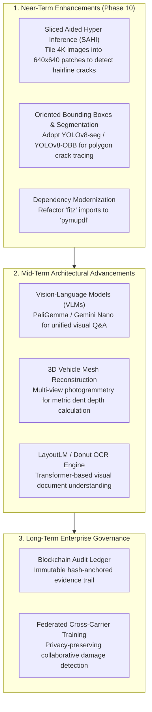

# ClaimSense AI — Phase 9.11: Known Limitations & Future Research Roadmap

**Project:** ClaimSense AI (Final-Year B.Tech Major Project)  
**Phase:** 9 — Model Evaluation & Optimization  
**Stage:** 9.11 — Final Documentation, Reproducibility & Project Sign-off  
**Date:** 2026-11-20

---

## 1. Executive Summary

This document presents an objective analysis of the known limitations of ClaimSense AI and outlines a strategic technical roadmap for future academic research and industrial engineering iterations.

Transparently acknowledging system limitations is essential for responsible AI deployment and ensures that the platform is deployed strictly within its validated operational boundaries.

---

## 2. Documented System Limitations

### 2.1 Domain-Level Structural Crack Detection Blindspot (ISS-01)
- **Nature of Limitation:** State-of-the-art YOLOv8 object detection fails to achieve operational recall on vehicle structural cracks ($0.0000\%$ recall at $\tau=0.25$, detecting 0 of 13 independent benchmark cracks).
- **Physical Cause:** Hairline cracks exhibit severe visual sparsity (sub-5-pixel widths), low tonal contrast against dark panels, and visual mimicry from surface reflections and panel body lines.
- **Operational Impact:** Claims involving bumper cracks or composite panel fractures cannot rely on automated visual confirmation and require manual examiner review.

### 2.2 2D Planar Photographic Perspective Constraints
- **Nature of Limitation:** Monocular 2D smartphone photographs cannot capture internal or concealed structural damage.
- **Failure Modes:** Chassis frame warping, suspension geometry misalignment, internal radiator puncturing, and hidden firewall fractures remain completely invisible to exterior photographic inspection.
- **Operational Impact:** The platform is strictly an **exterior damage triage system**; it cannot certify vehicle roadworthiness or mechanical integrity.

### 2.3 Class Imbalance & Precision-Recall Tension
- **Nature of Limitation:** CarDD dataset distributions are heavily skewed toward dents (39.9%) and scratches (33.8%).
- **Empirical Observation:** In Phase 9 retraining (Run P9-T02), scaling resolution to $640\times 640$ boosted overall precision (+85.2%) and eliminated 85.4% of false positives, but depressed overall recall (-27.8%) on dents, scratches, lamps, and flat tires.

### 2.4 OpenCV Traditional Computer Vision Fallback Scope
- **Nature of Limitation:** In environments where deep learning weights cannot be initialized, the OpenCV fallback pipeline identifies edge contours and contrast anomalies, but cannot semantically categorize damage types (e.g. distinguishing a dent from a scratch).
- **Design Mitigation:** By design, the fallback engine returns `total_detections = 0` to prevent fabricating unverified damage boxes.

### 2.5 Document Layout Variance in OCR Extraction
- **Nature of Limitation:** Deterministic regex-based field extraction operates reliably on standard insurer policy schedules and repair estimates, but degrades when encountering handwritten notes, multi-column unconventional layouts, or severe scan skew.

---

## 3. Future Technical Roadmap

---

## 4. Specific Technical Remediation Protocols

### 4.1 Sliced Aided Hyper Inference (SAHI) for Hairline Cracks
- **Strategy:** Rather than downsampling a $4000\times 3000$ camera image directly to $640\times 640$, SAHI partitions the original image into overlapping $640\times 640$ patches, runs inference at native resolution, and merges bounding boxes using Non-Maximum Suppression (NMS).
- **Projected Benefit:** Eliminates sub-pixel downsampling loss, allowing hairline fractures to maintain adequate receptive field resolution.

### 4.2 Polygon Instance Segmentation (YOLOv8-seg)
- **Strategy:** Transition from rectangular bounding boxes to pixel-level polygon segmentation masks.
- **Projected Benefit:** Reduces background noise in crack annotations. Rectangular boxes around diagonal cracks contain over 90% non-crack background pixels; polygon masks isolate only the fractured pixels.

### 4.3 Generative Synthetic Crack Augmentation
- **Strategy:** Utilize Diffusion / GAN-based inpainting models to synthetically inject diverse, realistic hairline cracks onto clean vehicle body panels in training sets.
- **Projected Benefit:** Elevates crack training representation from $<7\%$ to an equitable $20\%$, mitigating minority-class gradient starvation.

---

## 5. Roadmap Conclusion

The documented limitations provide clear, actionable engineering directions for future development iterations. ClaimSense AI's core evidence cross-referencing architecture remains robust, sound, and fully capable of accommodating these planned enhancements.
